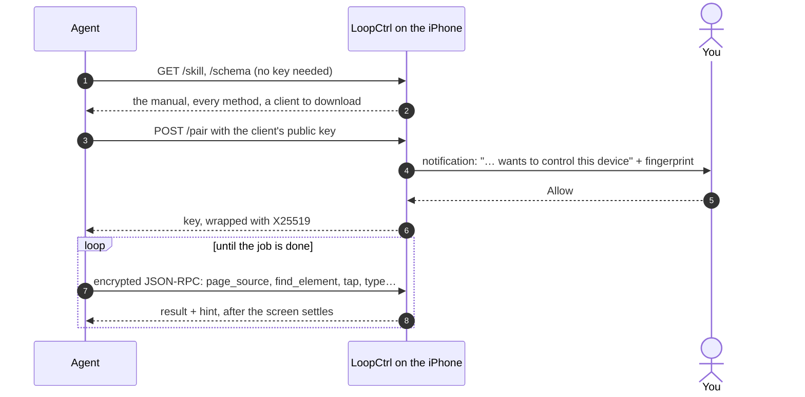

<p align="right"><b>English</b> · <a href="README.zh-CN.md">简体中文</a></p>

<p align="center">
  
</p>

<h1 align="center">LoopCtrl</h1>

<p align="center">
  <b>Give your AI agent an iPhone.</b><br>
  The phone serves its own manual, asks you before anyone pairs, and needs no Mac to keep running.
</p>

<p align="center">
  <a href="#install">Install</a> ·
  <a href="#requirements">Requirements</a> ·
  <a href="#approval">Pairing approval</a> ·
  <a href="#access">Access</a> ·
  <a href="#developers">For agents and developers</a> ·
  <a href="#security">Security</a> ·
  <a href="#limits">Known limits</a>
</p>

---

Start the server on the phone, then say one sentence to your agent:

```text
My iPhone runs LoopCtrl at 127.0.0.1:8300. Learn how to drive it, then open Settings and tell me the iOS version.
```

The agent reads the manual the phone serves, downloads a client from it and
asks to pair. You tap **Allow** in the notification. From then on it can see
the screen and tap, swipe and type in any app, the way you would.

Use `127.0.0.1` when the agent runs on the phone itself (Minis, for example).
For an agent on a computer on the same Wi-Fi, switch on **LAN Access** and use
the address the app shows. From anywhere else, connect through a
[remote service](#remote) or a [tailnet](#tailnet).

> [!CAUTION]
> **A paired client controls the whole phone**: every app, every screen,
> everything you could type. Approve only pairing requests you started
> yourself, and check that the key fingerprint on the phone matches the one
> your client prints. Keep LAN Access and remote connections off when you don't
> need them, and don't leave an agent alone with payments, messages or anything
> you can't undo. Use it on your own devices, for testing and research.

## What it does

- **Agents learn it on their own.** The phone serves an operating manual
  written for models (`GET /skill`), a schema of every method (`GET /schema`)
  and ready-made clients (`GET /skill/clients/…`). Actions wait for the screen
  to settle and come back with a `hint` for the next step; errors say how to
  recover.
- **It all runs on the phone.** The server is a long-lived XCUITest runner on
  the device. An agent on the same phone talks to it over `127.0.0.1`. The
  app mounts the Developer Disk Image itself, so after a reboot you need one
  tap, not a computer.
- **Nobody gets in without you.** Every client asks to pair and you approve it
  on the phone, after checking its key fingerprint. Every request after that is
  encrypted and authenticated. Clients can be revoked at any time.
- **One app to install.** The all-in-one build carries the app and the runner
  in a single IPA, so it uses one of a free Apple ID's three sideloading slots.



<a id="install"></a>
## Install

1. **Download `LoopCtrl-AllInOne.ipa`** from
   [Releases](https://github.com/Souitou-iop/LoopCtrl/releases). It is the
   recommended build and the only one attached to releases. `SHA256SUMS.txt`
   next to it has its checksum. The package is unsigned: it carries no
   provisioning profile, team id or device identifiers.
2. **Sign and install it.** With a free Apple ID, use the **latest SideStore**
   (My Apps → +). With a paid account on a Mac, run
   `Scripts/sign-ipa.sh -i LoopCtrl-AllInOne.ipa` and install the result. Then
   trust the certificate under Settings → General → VPN & Device Management,
   and turn on **Developer Mode** (Settings → Privacy & Security → Developer
   Mode, then restart).
3. **Pair once.** On iOS 27 and later, pair on the phone. Below iOS 27, pair
   once over USB with [LoopCtrl Pair](https://github.com/Souitou-iop/LoopCtrl-Pair)
   or import a pairing file. See [Requirements](#requirements).
4. **Mount the disk image.** Connect LocalDevVPN or Shadowrocket, open
   LoopCtrl and tap **Mount Disk Image**. The app walks you through it.
5. **Start.** Tap **Start Server**. The first time, iOS asks for your passcode
   and for **Notifications** and **Local Network**. Allow both: notifications
   are where you approve clients.

Now hand your agent the sentence at the top.

> [!NOTE]
> **After every reboot**, mount the disk image again (step 4). The pairing file
> and the downloaded images are kept, so it takes one tap.

<details>
<summary><b>Why not any signer?</b> And the other ways to sign and install</summary>

The runner carries a nested test bundle, `PlugIns/LoopCtrlUITests.xctest`. It
must be signed first, with the host app's bundle id. Signers that skip it
produce an app that **crashes as soon as it opens**. These routes handle it:

- **SideStore, latest version** (free Apple ID). Install it with
  [iLoader](https://github.com/nab138/iLoader), and keep
  [LocalDevVPN](https://apps.apple.com/app/localdevvpn/id6755608044)
  connected so it can refresh apps. Older SideStore builds signed with `ldid`
  and skipped the `.xctest`. Free certificates last 7 days, and SideStore
  renews them.
- **`Scripts/sign-ipa.sh`** (paid account, Mac). It finds your team, a
  development profile that covers the bundle id and the matching identity on
  its own (`-t`, `-p`, `-s` override them). It signs from the inside out,
  verifies every binary, and refuses a distribution profile. Install the
  output with Xcode (Devices and Simulators), Apple Configurator or
  `ideviceinstaller`.
- **Xcode** (paid account, Mac). Run `make build`, open `LoopCtrl.xcodeproj`,
  pick the **LoopCtrl** scheme and run **Product → Test**. Xcode also mounts the
  disk image for you. The runner keeps going after Xcode detaches.

</details>

<details>
<summary><b>The two-app build</b> (advanced, or as a fallback)</summary>

`make ipa` builds `LoopCtrl.ipa` and `LoopCtrlUITests-Runner.ipa`: the app and
the runner as two separate apps. The app starts the runner through its
`loopctrl://` URL scheme. It is not attached to releases, so build it from
source ([Build from source](#build)).

Use it if you want to drive the runner from Xcode, or if the all-in-one build
misbehaves on your device. It costs two sideloading slots, changing LAN Access
from the app needs one extra Allow, and the [remote service](#remote) needs
the all-in-one build.

</details>

<details>
<summary><b>Something's off</b></summary>

- **The runner opens and closes at once.** The disk image isn't mounted (often
  after a reboot), the `.xctest` wasn't signed, or the free certificate expired.
- **A computer can't connect.** LAN Access is off, Local Network access was
  denied, or the phone is on cellular. Test it with
  `curl http://<phone-ip>:8300/schema`.
- **The client says it's pairing, but no prompt appears.** Something else on
  the network answered. Don't trust it.

</details>

<a id="requirements"></a>
## Requirements by iOS version

The app runs on **iOS 16 and later**. What changes between versions is how you
pair and which Developer Disk Image the app mounts:

| iOS | Pairing | Disk image mounted on the phone |
|---|---|---|
| 16 | USB, once: [LoopCtrl Pair](https://github.com/Souitou-iop/LoopCtrl-Pair), or import a lockdown pairing file (`idevicepair`, jitterbugpair, iLoader) | Legacy `DeveloperDiskImage.dmg`, over lockdownd ([details](docs/ios16-ddi-mount.md)) |
| 17.0–17.3 | Not supported on the phone yet (see [Known limits](#limits)) | Mount from Xcode instead |
| 17.4–26.3 | USB, once: LoopCtrl Pair, or import a pairing file from iLoader | Personalized image |
| 26.4–26.x | USB, once: LoopCtrl Pair, or import a pairing file from iLoader | Cryptex image |
| 27 and later | **On the phone**: tap **Pair on this device**, then Settings → Privacy & Security → Developer Mode → "Pair with LoopCtrl" and enter the code | Cryptex image |

For every version:

- **A tunnel app** for the loopback: [LocalDevVPN](https://apps.apple.com/app/localdevvpn/id6755608044),
  or Shadowrocket with Settings → Other → "Include Route 10.7.0.1/32" on. It
  reflects one private address back to the phone and routes no other traffic.
- **Wi-Fi.** Any network works; cellular alone doesn't.
- **Disk images** are downloaded once from
  [doronz88/DeveloperDiskImage](https://github.com/doronz88/DeveloperDiskImage),
  pinned to one commit: jsDelivr first, then GitHub. Every file is checked
  against a pinned SHA-256 wherever it came from. On iOS 17 and later the first
  mount also needs internet, because Apple signs the image for your device.
- **LoopCtrl Pair** runs on Windows, macOS, Linux and Android (with USB OTG).
  It handles Trust and Developer Mode, creates the record your iOS version
  needs, writes it into LoopCtrl and verifies it. A file from `idevicepair`
  alone won't mount on iOS 17 and later: those versions need a RemotePairing
  record.

LoopCtrl's mounter is built on [idevice](https://github.com/jkcoxson/idevice).
Connecting the phone to Xcode on a Mac also mounts the image.

<a id="approval"></a>
## Pairing approval

Every new client needs your **Allow** on the phone, whichever way it
connects. Approving needs the phone unlocked.

- **The notification** shows the client's name, where it came from (this
  phone, USB, LAN, Nearby, Tailscale, VPN, relay…) and its key fingerprint.
  Long-press it to allow or deny. Swiping it away doesn't deny the request.
- **The home-screen card.** While a request waits, the home screen shows it
  with the same details, a countdown, and Allow and Deny. It stays until the
  request is answered or times out (60 s).
- **Allow after the fact.** Missed it? A denied or timed-out request stays in
  the recent list for 10 minutes. **Allow This Client** there lets that client
  in on its next try, with no new prompt. The grant is bound to the full
  SHA-256 of the client's public key, not to its name or the short
  fingerprint, and it is used once. The reference clients keep their pending
  key for 10 minutes so a retry matches.
- **The Authorization page** (**Authorized N clients** on the home screen, or
  Settings): the waiting request, the requests from the last 10 minutes with
  their outcome, and every client holding a key with where it connects from and
  when it was last active. Swipe to revoke one, or revoke all.

Details: [docs/pairing-approval.md](docs/pairing-approval.md).

<a id="access"></a>
## Access

Out of the box the server listens on `127.0.0.1` only. Each step below widens
who can *ask* to pair; every client still needs your Allow.

| | Who can ask to pair |
|---|---|
| Default | Apps on this phone, and a computer over USB |
| **LAN Access** on | Anyone on the same Wi-Fi who knows the address |
| **LAN + Nearby** | Also Apple devices close by, with no shared network (AWDL); the phone announces itself |
| **Remote service** | Operators named in an invite you accepted, through a relay |
| **Tailnet** | Devices on your Tailscale or Headscale network, with LAN Access on |

### LAN Access

Switch it on from the home screen or the server notification. The home screen
shows the server's addresses (tap one to copy it). The default port is
**8300**; change it in Settings (1024–65534) and the service restarts on the
new port. Nearby discovery uses the port above it. Don't share the port with
another automation app, because two runners on one port get in each other's
way.

Nearby discovery can be turned on only from the phone itself. With it on, a
client needs no address: `python3 loopctrl_rpc.py scan`, then
`--nearby "<name or id>"`.

<a id="remote"></a>
### Remote service

**Remote Service** on the home screen connects the phone to a relay, so an
operator on another network can reach it. Add a connection from:

- an **invite link** (`loopctrl://connect?…`), pasted or opened;
- a **QR code**, scanned with the camera or picked from Photos;
- **manual entry** of the server address and connection code.

The **confirmation screen** shows the server, whether the connection is
encrypted and the certificate pinned, the operators the invite names, and what
they will be able to do. When the invite names its operators, the app checks
them against what the server reports and refuses a mismatch. Confirming
**pre-approves exactly those operators' keys**, and only for requests that
come through that relay. An invite that names none (manual entry, text form)
pre-approves nobody: you compare fingerprints, and each operator is asked about
like any other client.

From the connection's page you can **disconnect** (keep the binding, reconnect
later) or **unbind** (the relay forgets this phone). It also shows who is
operating, recent activity and the relay's certificate.

The relay is **untrusted**. It forwards end-to-end encrypted envelopes, and
pairing and every request stay sealed between the operator's client and the
phone. The phone's own credential is an Ed25519 key that stays in its Keychain.
There is **no server built into the app**: use a provider, or host your own
(see [Self-hosting](#self-hosting)). Protocol and enrollment API:
[docs/relay-enrollment.md](docs/relay-enrollment.md). Remote connections work
in the all-in-one build only.

<a id="tailnet"></a>
### Tailscale and Headscale

A tailnet is another way in. Put the phone on a Tailscale or Headscale
network, switch on LAN Access, and give the agent the phone's tailnet address
(`100.x.y.z`). Requests from tailnet addresses (100.64.0.0/10 and
fd7a:115c:a1e0::/48) show up as tailnet peers in the approval prompt and on
the Authorization page, and are treated as remote, never as local. Shadowrocket
can run a tailnet node and the loopback route at the same time, which saves
juggling two VPNs.

<a id="self-hosting"></a>
## Self-hosting

The reference relay and a Headscale deployment live in
[LoopCtrl-Server](https://github.com/Souitou-iop/LoopCtrl-Server). Anyone can
also implement the relay API from [docs/relay-enrollment.md](docs/relay-enrollment.md).

<a id="developers"></a>
## For agents and developers

### The API

JSON-RPC 2.0 over `POST /rpc`, inside an encrypted envelope. There is no
plaintext mode. `GET /schema` lists every method and parameter, and
[`SKILL.md`](SKILL.md) is the manual the phone serves at `GET /skill`.

- **See**: `page_source`, `find_element`, `screen_text` (on-device OCR), `screenshot`, `collect`
- **Touch**: `tap`, `double_tap`, `long_press`, `tap_element`, `find_and_tap`, `swipe`, `scroll`, `scroll_to_element`, `page`, `drag`
- **Type**: `type`, `clear_text`
- **Apps**: `resolve_app`, `launch_app`, `activate_app`, `terminate_app`, `list_apps`, `open_url`
- **Device**: `device_info`, `home`, `lock`, `unlock`, `is_locked`, `wait`
- **Server**: `config`, `logs`, `reset`, `stream_ticket`

`device_info` reports a `capabilities` list, so a client checks features
instead of comparing versions. Plain HTTP: `/skill`, `/schema`, `/whoami`,
`/docs` and `/pair` need no key. `/remote` is a browser control page that asks
for a key before it controls anything. `/stream` (live H.264) and `/logs` take
a single-use ticket from `stream_ticket`.

### Clients

| Client | Download from | Good for |
|---|---|---|
| Python, [`Scripts/loopctrl_rpc.py`](Scripts/loopctrl_rpc.py) | `/skill/clients/python` | Any OS. Standard library only; pairing over the network also needs `cryptography`. Includes `scan` and `--nearby`. |
| Static CLI, [`cli/`](cli/) | `/skill/clients/cli` + `/skill/clients/cli.sh` | Sandboxes with no interpreter. `aarch64-linux-musl`, no dependencies; run it as `sh loopctrl.sh …`. |

```bash
curl -o loopctrl_rpc.py http://<phone>:8300/skill/clients/python
python3 loopctrl_rpc.py --host <phone>:8300 pair              # tap Allow on the phone
python3 loopctrl_rpc.py --host <phone>:8300 call device_info
python3 loopctrl_rpc.py --host <phone>:8300 call find_element '{"element_id":"Wi-Fi"}'
```

Keys are kept per device in `~/.loopctrl/token.json`, which both clients
share, so one pairing works over USB, Wi-Fi and Nearby alike. A key that goes
unused for 30 days expires.

<details>
<summary><b>The pairing and envelope protocol</b></summary>

- `POST /pair` waits up to 60 s for the user to tap Allow. Over the network the
  client sends an X25519 public key, and the 32-byte key `K` comes back wrapped:
  `K = token_ct XOR HMAC(HMAC(X25519(c_priv, d_pub), "loopctrl-pair" || c_pub || d_pub), "loopctrl-wrap")`.
  From `127.0.0.1` only, `{"client_name": "…", "plain": true}` returns `K`
  directly.
- Each request is sealed with HMAC-SHA256 keys derived from `K` and a fresh
  nonce. Replays are refused, and so are timestamps more than ±120 s off.
- Only one request waits at a time, with a cooldown after a refusal. Requests
  from the phone itself get their own slot.
- Keys live in the app's sandbox, not the Keychain, so re-signing the app keeps
  them.

The reference implementations are `Scripts/loopctrl_rpc.py` and `cli/main.c`.

</details>

### Research notes

[`docs/research/`](docs/research/) has measurements and designs behind the
manual: [control speed and accuracy](docs/research/control-speed-accuracy.md),
the [cross-app playbook design](docs/research/operation-playbook-design.md),
[how app knowledge is kept](docs/research/app-knowledge-workflow.md) and the
[SKILL.md A/B test](docs/research/skill-ab-test.md) (kit in
[`tools/skill-ab/`](tools/skill-ab/)).

<a id="build"></a>
### Build from source

You need macOS, Xcode (signed in with any Apple ID), XcodeGen and Rust:

```bash
brew install xcodegen
rustup target add aarch64-apple-ios
make ipa-allinone            # → LoopCtrl-AllInOne.ipa  (one app, what releases ship)
make ipa                     # → LoopCtrl.ipa + LoopCtrlUITests-Runner.ipa  (two apps)
```

- Add `UNSIGNED=1` to skip Xcode signing and sign ad hoc (bundle prefix
  `com.openminis`). Use it for IPAs that SideStore or `sign-ipa.sh` will
  re-sign anyway.
- `Scripts/package-release.sh` strips your provisioning profile (name, team,
  device UDIDs) from `LoopCtrl-AllInOne.ipa` before you share it; add
  `--two-app` to package the two-app build too. Releases are built by
  [`.github/workflows/release.yml`](.github/workflows/release.yml).
- The first `make` builds the idevice framework from source (several minutes,
  once). It also writes `Config/Local.xcconfig` with your team and bundle
  prefix, and generates the Xcode project from `project.yml`. Change signing
  there, not in Xcode.
- [`docs/runner-merge-spike.md`](docs/runner-merge-spike.md) (in Chinese)
  explains how the all-in-one build loads the runner in-process.
- **The CLI** builds separately with Docker or `zig`: `make -C cli build`,
  `make -C cli test`, or `make -C cli macos` for a macOS client with Nearby
  support. `cli/loopctrl` is committed because the runner bundles it, so
  rebuild it when `cli/main.c` or the protocol changes.

| Folder | What's in it |
|---|---|
| `LoopCtrlApp/` | The SwiftUI app: home screen, Settings, remote service, pairing and disk-image mounting (`DDI/`), the in-process runner (`Runner/`) |
| `LoopCtrlUITests/` | The automation engine: the runner, action handlers, strings in every language |
| `LoopCtrlKit/` | Shared by both: HTTP server, pairing and envelope, the method registry, invites |
| `cli/`, `Scripts/` | Clients, signing and packaging scripts |
| `SKILL.md` | The manual the phone serves at `/skill` |

<a id="security"></a>
## Security model

- The server listens on `127.0.0.1` until you widen access, and each widening
  is a switch on the phone.
- Every client pairs with an X25519 key and needs your Allow on the phone. The
  fingerprint lets you check it is the client you meant.
- Every `/rpc` request is encrypted and authenticated with a per-client key;
  replays and stale timestamps are refused. Keys expire after 30 days unused
  and can be revoked at any time.
- Pre-approval is narrow: an after-the-fact Allow is one-shot and bound to one
  public key; a remote invite pre-approves only the keys it names, and only
  through that relay.
- Relays are untrusted and see only sealed envelopes.
- Not covered: the endpoints that need no key, and the screen stream, are not
  encrypted on any channel.

<a id="limits"></a>
## Known limits

- It uses private XCTest and system APIs. It is not for the App Store, and a
  future iOS version may break parts of it. Newer iOS already refuses the full
  app list, so `list_apps` falls back to the apps LoopCtrl has opened before;
  use `resolve_app` and `launch_app` to find an app.
- **iOS 16** support is unverified on a device: the legacy mount is written
  and checked against idevice's source, but whether the in-process XCTest
  bootstrap works there has not been tested.
- **iOS 17.0–17.3**: the on-phone mounter needs a RemotePairing record, which
  can't be created over plain USB on these versions. Mount from Xcode instead.
- **LoopCtrl Pair → LoopCtrl**: LoopCtrl doesn't yet pick up the pairing file
  LoopCtrl Pair writes into it; that import is still being built. Until it
  lands, import a pairing file in Settings.
- **The "Automation Running" overlay** shows while the server runs. In the
  all-in-one build, Stop hands automation back so the overlay goes, and Start
  takes it again (iOS may ask for your passcode). If iOS refuses to hand it
  back, the server log says so and the overlay stays until LoopCtrl quits:
  swipe it away in the app switcher.
- `unlock` wakes the screen but can't enter a passcode. For long unattended
  runs, set Auto-Lock to Never. The server keeps running while the screen is
  off.
- Apps with bot detection may still notice automation.
- If an older runner left large "System Data" behind, connect over USB and run
  `Scripts/clean-xctest-attachments.sh` to list it, then run it with `--delete`.

## License

Apache License 2.0, see [`LICENSE`](LICENSE). [`NOTICE.md`](NOTICE.md) covers
third-party components and the earlier AGPL-3.0 releases.

LoopCtrl started as a fork of iCTRL. It builds on
[idevice](https://github.com/jkcoxson/idevice) (MIT) for pairing and mounting,
and calls [LocalDevVPN](https://github.com/jkcoxson/LocalDevVPN) as a separate
app for the tunnel. It downloads disk images at runtime from
[doronz88/DeveloperDiskImage](https://github.com/doronz88/DeveloperDiskImage).
[StikDebug](https://github.com/StikDebug/StikDebug) inspired the on-device
mounting, and [WebDriverAgent](https://github.com/appium/WebDriverAgent)
pioneered the long-lived XCUITest runner. LoopCtrl copies no code from either.
