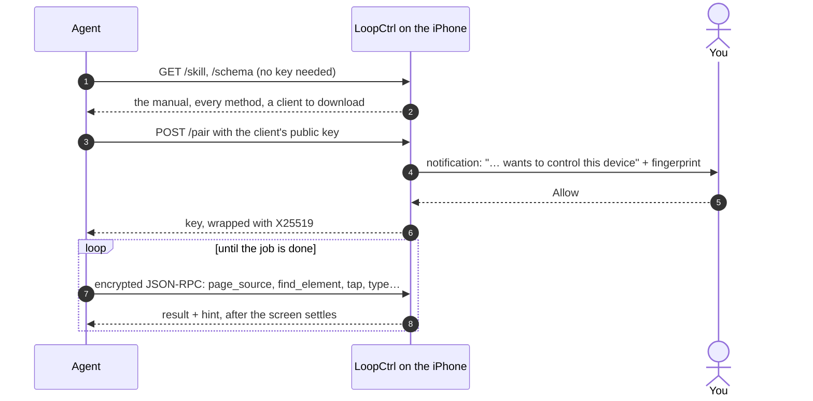

<p align="right"><b>English</b> · <a href="README.zh-CN.md">简体中文</a></p>

<p align="center">
  
</p>

<h1 align="center">LoopCtrl</h1>

<p align="center">
  <b>Give your AI agent an iPhone.</b><br>
  The phone serves its own manual, asks you before anyone pairs, and needs no Mac to keep running.
</p>

<p align="center">
  <a href="#why">Why LoopCtrl</a> ·
  <a href="#setup">Put it on a phone</a> ·
  <a href="#daily">Day to day</a> ·
  <a href="#clients">Write a client</a> ·
  <a href="#build">Build from source</a>
</p>

---

Start the server on the phone, then say one sentence to your agent:

```text
My iPhone runs LoopCtrl at 127.0.0.1:8300. Learn how to drive it, then open Settings and tell me the iOS version.
```

The agent reads the manual the phone serves, downloads a client from it and
asks to pair. You tap **Allow** in the notification. From then on it can see
the screen and tap, swipe and type in any app, the way you would.

Use `127.0.0.1` when the agent runs on the phone itself (Minis, for example).
For an agent on a computer, switch on **Remote Access** and use the Wi-Fi
address the app shows.

> [!CAUTION]
> **A paired client controls the whole phone**: every app, every screen,
> everything you could type. Approve only pairing requests you started
> yourself, and check that the key on the phone matches the one your client
> prints. Keep Remote Access off when you don't need it, and don't leave an
> agent alone with payments, messages or anything you can't undo. Use it on
> your own devices, for testing and research.

<a id="why"></a>
## Why LoopCtrl

**1. Agents can learn it on their own.** You don't paste API docs into a
prompt. The phone serves an operating manual written for models
(`GET /skill`), a schema of every method (`GET /schema`) and ready-made clients
(`GET /skill/clients/…`). Replies are written for the agent too: actions wait
for the screen to settle and say so, and they come back with a `hint` about
what to do next. Errors say how to recover, and element `ref`s warn when a
label matches something off screen or a look-alike. `device_info` reports a
`capabilities` list, so a client checks features instead of comparing versions.

**2. All of it runs on the phone.** The server is an XCUITest runner on the
device. An agent on the same phone talks to it over `127.0.0.1`, with no
computer anywhere. Setup can stay on the phone too: install with a free Apple ID
through SideStore, pair on the device (iOS 27 and later) or import a pairing
file, and mount the Developer Disk Image from the app through a tunnel app
(LocalDevVPN or Shadowrocket). A Mac is optional.

**3. Nobody gets in without you.** Out of the box the server listens on
`127.0.0.1` only. Every client asks to pair, and you approve it on the phone,
where a key fingerprint lets you check it is the client you meant. After
that, every request is encrypted and authenticated, and stale or replayed
requests are refused. You can revoke clients from the app at any time.

**4. One app to install.** The all-in-one build puts the app and the runner in
a single IPA. That uses one of a free account's three sideloading slots, and
Start, Stop and Start again all happen without leaving LoopCtrl.

<a id="how"></a>
## How it works



Under the hood, LoopCtrl is a long-lived XCUITest session that iOS keeps open
while the server runs. That is why it can reach every app, and why it needs the
Developer Disk Image mounted first.

<a id="setup"></a>
## Put it on a phone

You need an iPhone with **Developer Mode** on (Settings → Privacy & Security →
Developer Mode, then restart). The app runs on iOS 16 and later, but mounting
the disk image on the phone itself needs **iOS 17 or later**, and pairing on the
phone needs **iOS 27**. On iOS 16, mount the image from a computer with
Xcode or `devicectl`.

1. **Get the IPA.** Build `LoopCtrl-AllInOne.ipa` with
   `make ipa-allinone UNSIGNED=1` ([Build from source](#build)), or use one
   someone built for you.
2. **Sign and install it.** With a free Apple ID, use the **latest SideStore**
   (My Apps → +). With a paid account, run `Scripts/sign-ipa.sh -i LoopCtrl-AllInOne.ipa`
   and install the result. Then trust the certificate under
   Settings → General → VPN & Device Management.
3. **Mount the disk image.** Open LoopCtrl and tap **Mount Disk Image**. The
   app walks you through it: pair, download the image files once, connect to
   Wi-Fi, connect the tunnel app, mount.
4. **Start.** Tap **Start Server**. The first time, iOS asks for your passcode
   and for **Notifications** and **Local Network**. Allow both, because
   notifications are where you approve clients.

Now hand your agent the sentence at the top.

> [!NOTE]
> **After every reboot**, mount the disk image again (step 3). Your pairing
> file and the downloaded images are kept, so it takes one tap.

<details>
<summary><b>Why not any signer?</b> And the other ways to sign and install</summary>

The runner carries a nested test bundle, `PlugIns/LoopCtrlUITests.xctest`. It
must be signed first, with the host app's bundle id. Signers that skip it
produce an app that **crashes as soon as it opens**. These routes handle it:

- **SideStore, latest version** (free Apple ID). Install it with
  [iLoader](https://github.com/nab138/iLoader), and keep
  [LocalDevVPN](https://apps.apple.com/app/localdevvpn/id6755608044)
  connected so it can refresh apps. Older SideStore builds signed with `ldid`
  and skipped the `.xctest`. Free certificates last 7 days, and SideStore
  renews them.
- **`Scripts/sign-ipa.sh`** (paid account, Mac). It finds your team, a
  development profile that covers the bundle id and the matching identity on
  its own (`-t`, `-p`, `-s` override them). It signs from the inside out,
  verifies every binary, and refuses a distribution profile. Install the
  output with Xcode (Devices and Simulators), Apple Configurator or
  `ideviceinstaller`.
- **Xcode** (paid account, Mac). Run `make build`, open `LoopCtrl.xcodeproj`,
  pick the **LoopCtrl** scheme and run **Product → Test**. Xcode also mounts the
  disk image for you. The runner keeps going after Xcode detaches.

</details>

<details>
<summary><b>Mounting the disk image</b>: what the app needs, and the alternatives</summary>

On recent iOS, developer services are only reachable through a tunnel. The
tunnel app (LocalDevVPN, or Shadowrocket with Settings → Other →
"Include Route 10.7.0.1/32" on) reflects one private address back to the
phone. It routes no other traffic. LoopCtrl's mounter is built on
[idevice](https://github.com/jkcoxson/idevice).

- **Pairing.** On iOS 27 and later, tap **Pair on this device**, then go to
  Settings → Privacy & Security → Developer Mode → "Pair with LoopCtrl" and
  enter the code the app shows. On iOS 17 to 26, pair once on a computer over USB and import the
  resulting pairing file, or import one exported by iLoader (iOS 17.4 or
  later). A file from `idevicepair` alone won't mount. LoopCtrl's own desktop
  pairing tool is planned.
- **Mounting.** The on-device mounter supports iOS 17 and later: the
  personalized image on 17 to 26.3, the cryptex image on 26.4 and later.
- **Network.** Any Wi-Fi works; cellular alone doesn't. The first mount needs
  internet access, because Apple signs the image for your specific device.
- **Other ways.** Connecting to Xcode on a Mac mounts it, and so does
  [StikDebug](https://github.com/StikDebug/StikDebug).

</details>

<details>
<summary><b>Something's off</b></summary>

- **The runner opens and closes at once.** The disk image isn't mounted (often
  after a reboot), the `.xctest` wasn't signed, or the free certificate expired.
- **A computer can't connect.** Remote Access is off, Local Network access was
  denied, or the phone is on cellular. Test it with
  `curl http://<phone-ip>:8300/schema`.
- **The client says it's pairing, but no prompt appears.** Something else on
  the network answered. Don't trust it.

</details>

<a id="daily"></a>
## Day to day

**The home screen** shows where things stand (pairing, disk image, service)
and offers one button for the next step: mount, start or stop. While the
server runs, the home screen shows the server's addresses (tap one to copy
it) and the **Remote Access** switch.

**Settings** is where you pair and mount, change the port, see who is
authorized and revoke them, read the runner's and the app's logs, and look up
the server's version and capabilities.

**Notifications** carry the same controls when you're in another app.
Long-press the server notification to switch Remote Access or Nearby Discovery
or to stop the server, and long-press a pairing request to allow or deny it.
Missed the notification? While a request waits, the home screen shows it as a
card with Allow and Deny, and **Authorized N clients** opens the Authorization
page: the waiting request, requests from the last 10 minutes (a timed-out one
can still be allowed, and the client gets in on its next try), and every
client holding a key, with revoke.
Approving needs the phone unlocked.

**Who can reach it.** It goes one step at a time, and each step needs you on
the phone:

| | Who can ask to pair |
|---|---|
| Default | Apps on this phone, and a computer over USB |
| **Remote Access** on | Anyone on the same Wi-Fi who knows the address |
| **Nearby Discovery** on | Also Macs close by, with no shared network (peer-to-peer Wi-Fi); the phone announces itself |

Every client still needs your **Allow**, whichever step you're on. Nearby
Discovery can be turned on only from the phone itself. With it on, a client
needs no address at all:
`python3 loopctrl_rpc.py scan`, then `--nearby "<name or id>"`.

**Port.** The default is **8300**. You can change it in Settings (1024–65534)
while the server is stopped; Nearby Discovery uses the port above it. Don't
share a port with another automation app such as iCTRL, because two runners
on one port get in each other's way.

> [!NOTE]
> **Known issue.** After you stop the server in the all-in-one build, iOS's
> "Automation Running" overlay stays until LoopCtrl quits. It's under
> investigation; until then, swipe LoopCtrl away from the app switcher to
> clear it.

<a id="clients"></a>
## Write a client

Every `/rpc` request travels in an encrypted envelope, and there is no
plaintext mode. Start from a client the phone serves:

| Client | Download from | Good for |
|---|---|---|
| Python, [`Scripts/loopctrl_rpc.py`](Scripts/loopctrl_rpc.py) | `/skill/clients/python` | Any OS. Standard library only; pairing over Wi-Fi also needs `cryptography`. Includes `scan` and `--nearby`. |
| Static CLI, [`cli/`](cli/) | `/skill/clients/cli` + `/skill/clients/cli.sh` | Sandboxes with no interpreter. `aarch64-linux-musl`, no dependencies; run it as `sh loopctrl.sh …`. |

```bash
curl -o loopctrl_rpc.py http://<phone>:8300/skill/clients/python
python3 loopctrl_rpc.py --host <phone>:8300 pair              # tap Allow on the phone
python3 loopctrl_rpc.py --host <phone>:8300 call device_info
python3 loopctrl_rpc.py --host <phone>:8300 call find_element '{"element_id":"Wi-Fi"}'
```

Keys are kept per device in `~/.loopctrl/token.json`, which both clients
share. One pairing then works over USB, Wi-Fi and Nearby alike. A key that goes
unused for 30 days expires.

**Methods** (JSON-RPC 2.0 over `POST /rpc`; `GET /schema` has every parameter):

- **See**: `page_source`, `find_element`, `screen_text` (on-device OCR), `screenshot`, `collect`
- **Touch**: `tap`, `double_tap`, `long_press`, `tap_element`, `find_and_tap`, `swipe`, `scroll`, `scroll_to_element`, `page`, `drag`
- **Type**: `type`, `clear_text`
- **Apps**: `resolve_app`, `launch_app`, `activate_app`, `terminate_app`, `list_apps`, `open_url`
- **Device**: `device_info`, `home`, `lock`, `unlock`, `is_locked`, `wait`
- **Server**: `config`, `logs`, `reset`, `stream_ticket`

**Plain HTTP**: `/skill`, `/schema`, `/whoami`, `/docs` and `/pair` need no key.
`/remote` is a browser control page that you can add to the Home Screen, and
it asks for a key before it controls anything. `/stream` (live H.264) and
`/logs` take a single-use ticket from `stream_ticket`.

<details>
<summary><b>The pairing and envelope protocol</b></summary>

- `POST /pair` waits up to 60 s for the user to tap Allow. Over the network the
  client sends an X25519 public key, and the 32-byte key `K` comes back wrapped:
  `K = token_ct XOR HMAC(HMAC(X25519(c_priv, d_pub), "loopctrl-pair" || c_pub || d_pub), "loopctrl-wrap")`.
  From `127.0.0.1` only, `{"client_name": "…", "plain": true}` returns `K`
  directly.
- Each request is sealed with HMAC-SHA256 keys derived from `K` and a fresh
  nonce. Replays are refused, and so are timestamps more than ±120 s off.
- Only one request waits at a time, with a cooldown after a refusal. Requests
  from the phone itself get their own slot.
- A refused or timed-out request stays in the app's recent list for 10 minutes.
  Allowing it there arms a one-shot grant bound to the SHA-256 of the client's
  X25519 public key: the next `/pair` with that same key is approved without a
  prompt or cooldown. The reference clients reuse a pending key for 10 minutes
  for this. A plain (keyless) request can't be allowed afterwards. Details:
  [docs/pairing-approval.md](docs/pairing-approval.md).
- Keys live in the app's sandbox, not the Keychain, so re-signing the app keeps
  them.

The reference implementations are `Scripts/loopctrl_rpc.py` and `cli/main.c`.

</details>

<a id="build"></a>
## Build from source

You need macOS, Xcode (signed in with any Apple ID), XcodeGen and Rust:

```bash
brew install xcodegen
rustup target add aarch64-apple-ios
make ipa-allinone            # → LoopCtrl-AllInOne.ipa  (one app)
make ipa                     # → LoopCtrl.ipa + LoopCtrlUITests-Runner.ipa  (two apps)
```

- Add `UNSIGNED=1` to skip Xcode signing and sign ad hoc (bundle prefix
  `com.openminis`). Use it for IPAs that SideStore or `sign-ipa.sh` will
  re-sign anyway.
- `Scripts/package-release.sh` strips your provisioning profile (name, team,
  device UDIDs) from built IPAs before you share them.
- The first `make` builds the idevice framework from source (several minutes,
  once). It also writes `Config/Local.xcconfig` with your team and bundle
  prefix, and generates the Xcode project from `project.yml`. Change signing
  there, not in Xcode.
- **The two-IPA build** installs the app and the runner separately; the app
  starts the runner through its `loopctrl://` URL scheme. It uses two
  sideloading slots, and changing Remote Access from the app needs one Allow.
  [`docs/runner-merge-spike.md`](docs/runner-merge-spike.md) (in Chinese)
  explains how the all-in-one build loads the runner in-process.
- **The CLI** builds separately with Docker or `zig`: `make -C cli build`,
  `make -C cli test`, or `make -C cli macos` for a macOS client with Nearby
  support. `cli/loopctrl` is committed because the runner bundles it, so
  rebuild it when `cli/main.c` or the protocol changes.

| Folder | What's in it |
|---|---|
| `LoopCtrlApp/` | The SwiftUI app: home screen, Settings, pairing and disk-image mounting (`DDI/`), the in-process runner (`Runner/`) |
| `LoopCtrlUITests/` | The automation engine: the runner, action handlers, strings in every language |
| `LoopCtrlKit/` | Shared by both: HTTP server, pairing and envelope, the method registry |
| `cli/`, `Scripts/` | Clients, signing and packaging scripts |
| `SKILL.md` | The manual the phone serves at `/skill` |

## Limits

- It uses private XCTest and system APIs. It is not for the App Store, and a
  future iOS version may break parts of it. Newer iOS already refuses the
  full app list, so `list_apps` falls back to the apps LoopCtrl has opened
  before. Use `resolve_app` and `launch_app` to find an app.
- `unlock` wakes the screen but can't enter a passcode. For long unattended
  runs, set Auto-Lock to Never. The server keeps running while the screen is
  off.
- Apps with bot detection may still notice automation.
- Endpoints that need no key also answer over Nearby, and the screen stream is
  not encrypted on any channel.
- If an older runner left large "System Data" behind, connect over USB and run
  `Scripts/clean-xctest-attachments.sh` to list it, then run it with `--delete`.

## License

Apache License 2.0, see [`LICENSE`](LICENSE). [`NOTICE.md`](NOTICE.md) covers
third-party components and the earlier AGPL-3.0 releases.

LoopCtrl started as a fork of iCTRL. It builds on
[idevice](https://github.com/jkcoxson/idevice) (MIT) for pairing and mounting,
and calls [LocalDevVPN](https://github.com/jkcoxson/LocalDevVPN) as a separate
app for the tunnel. It downloads disk images at runtime from
[doronz88/DeveloperDiskImage](https://github.com/doronz88/DeveloperDiskImage).
[StikDebug](https://github.com/StikDebug/StikDebug) inspired the on-device
mounting, and [WebDriverAgent](https://github.com/appium/WebDriverAgent)
pioneered the long-lived XCUITest runner. LoopCtrl copies no code from either.
