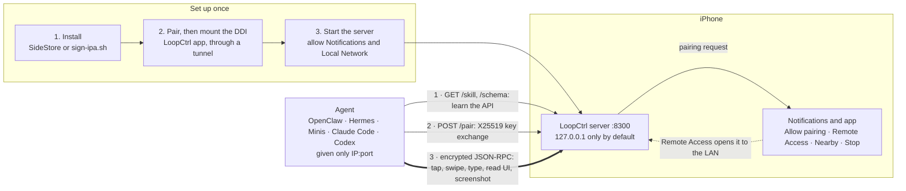

<p align="right"><b>English</b> | <a href="README.zh-CN.md">简体中文</a></p>

<p align="center"></p>

<h1 align="center">LoopCtrl</h1>

<p align="center"><b>An iPhone you can hand to an AI agent: encrypted JSON-RPC automation, built on XCUITest.</b></p>

> [!WARNING]
> **For automated testing and research only.** LoopCtrl hands full control of a
> phone (taps, text input, screen contents, every installed app) to whoever
> holds a paired key. Any automation like this can be hijacked or misused:
> a leaked key, a client you shouldn't have approved, or an agent acting on
> instructions it picked up along the way. **Weigh the risks before you use it:**
> - Run it only on devices you own and accounts you are entitled to automate.
> - Approve only the pairing requests you started.
> - Leave remote access off unless you need it, and stop the server when you
>   are done.
> - Don't leave an agent unsupervised around payments, messages or anything
>   that can't be undone.
>
> You are responsible for how you use it, including compliance with the terms
> of the apps you automate.

## What it is

LoopCtrl runs a long-lived XCUITest runner on the iPhone. The runner serves a
**JSON-RPC 2.0 API over HTTP**, with every request encrypted, so an AI agent
(or any HTTP client) can tap, swipe, type, read the UI tree, take screenshots,
launch apps, open URLs and more.

It is designed to be **discovered and driven by a model**. The device serves its
own operating manual at `GET /skill` and the full method list, with parameters,
at `GET /schema`, so an agent given only an address can learn the API at runtime.
Any agent that can make HTTP requests works, for example OpenClaw, Hermes, Minis,
Claude Code or Codex.

Once the server is running (with Remote Access on, if the agent isn't on the
phone), tell your agent:

> *"My iPhone is running LoopCtrl at 192.168.1.20:8300. Figure out how to drive it."*

It reads the manual, downloads a client from the device and asks to pair. You
approve the request on the phone, and it takes it from there.



An agent on the phone itself (Minis, for example) reaches the server on
`127.0.0.1`. An agent on another machine needs **Remote Access** turned on and
the same Wi-Fi network.

| | |
|---|---|
| **Bundle ID** | `com.openminis.loopctrl` (the runner uses `com.openminis.loopctrl.uitests` in the two-IPA build; a source build uses your own prefix, see [Building](#building)) |
| **Transport** | JSON-RPC 2.0 over HTTP. Default port **8300**, changeable in the app (Settings → Port). Nearby discovery uses the port above it (8301). |
| **Auth** | Encrypted envelope: X25519 pairing, then HMAC-SHA256 sealed requests |
| **Needs** | iOS 16 or later; a way to sign the IPA (free Apple ID via SideStore, or a paid account); the Developer Disk Image mounted |

> **Port 8300, not 8200.** The default moved away from iCTRL's 8200 so LoopCtrl
> and iCTRL can both be installed. Two runners on one port collide, and the one
> still holding it keeps iOS's "Automation Running" banner up after the other
> has stopped. If you pick a port yourself, don't share it with another
> automation app.

## Two builds

| | **All-in-one** (`LoopCtrl-AllInOne.ipa`) | **Two IPAs** (`LoopCtrl.ipa` + `LoopCtrlUITests-Runner.ipa`) |
|---|---|---|
| Apps installed | One | Two: the app, and the runner that does the automation |
| How the server starts | The app loads the runner's XCTest bundle in-process after the Developer Disk Image is mounted | The app opens the runner through its `loopctrl://` URL scheme |
| Free Apple ID app limit | Uses one of the 3 slots | Uses two |
| Stop | Parks the server, LoopCtrl stays open, Start works again | The runner exits |
| Status | **Experimental.** `docs/runner-merge-spike.md` is a feasibility spike and its on-device checklist (background survival, SideStore re-signing) is not marked as completed. | The established path |

Both are built from the same sources. The app is the same in both; only how
the server is launched differs. The all-in-one app has the same bundle id as
`LoopCtrl.ipa`, so it replaces that install. Paired keys, logs and settings are
kept per app container and are not migrated from an older runner.

## The app

The home screen shows three states and one action:

| Row | Values |
|---|---|
| **Pairing** | Paired / Not paired |
| **Disk Image** | Mounted / Not mounted / Unavailable |
| **Service** | Checking / Running / Stopped |

The one primary button follows the next step: **Mount Disk Image**, then
**Start Server**, then **Stop Server**. While the server runs, the home screen
also shows its **This device** address (`127.0.0.1:<port>`), the **Wi-Fi**
address once Remote Access is on, and the **Remote Access** switch. Tap an
address to copy it.

The gear opens **Settings**:

- **Pairing & Disk Image**: pairing and mounting, in one flow:
  - pair on this device (iOS 27 and later: Settings → Privacy & Security →
    Developer Mode → "Pair with LoopCtrl", then type the code the app shows), or
    import a pairing file (from StikPair, or from iLoader exported on iOS 17.4
    or later; a file from `idevicepair` alone won't mount);
  - choose the **tunnel app**, LocalDevVPN or Shadowrocket (with Settings →
    Other → "Include Route 10.7.0.1/32" on);
  - download the image files, then mount. About 100 MB up to iOS 26.3, about
    17 MB from iOS 26.4.
- **Port**: 1024 to 65534, locked while the server runs, with a restore-default
  button.
- **Server details** (while running): address, server version, protocol,
  methods, capabilities, **Visibility** (this device only, LAN, LAN + nearby),
  **Authorized Clients** (with revoke) and **Runner Logs**.
- **Alternative** (while the image isn't mounted): links to LocalDevVPN and StikDebug.
- **Device** (model, system, screen, name), **About** and this app's own **Logs**.

Managing clients and reading runner logs need this app paired with the runner
once, like any other client (one Allow). In the all-in-one build the server
shares the app's process, so the Remote Access switch needs no pairing.

## Features

- **Self-describing.** `GET /skill` is the operating manual (kept under 15K
  characters, most important rules first); `GET /schema` lists every method.
- **Responses that steer.** Results carry a `hint` and errors say what to do
  next. A `ref` re-resolves the live element at tap time; `visibility` and
  `alternatives` flag look-alikes; scrolls report whether they moved.
- **Knows the apps on the phone.** `resolve_app` turns a name into a bundle id
  offline and remembers which apps actually opened on this device.
- **Fast.** Taps are synthesized touch events with no wait-for-idle (about
  280 ms median in the author's measurements). `page_source` is bounded on the
  device (`visible_only`, `max_children`), so long feeds don't turn into
  seconds-long reads.
- **Sees what the accessibility tree can't.** `screen_text` runs on-device
  Vision OCR and returns text with tappable coordinates; `page_source` falls
  back to it when the tree comes back thin.
- **Robust when unattended.** Calls for an app that has left the screen are
  refused in milliseconds. `logs`, `config` and `reset` keep answering while UI
  calls hang, and logs survive a crash.
- **Secure by default.** Pairing is approved on the phone; every request is
  encrypted and authenticated, with replay and clock-skew protection. Remote
  access is off until you turn it on.
- **No Mac needed.** Install with a free Apple ID through SideStore, pair and
  mount the Developer Disk Image on the device.
- **Also included.** A live H.264 screen stream (`GET /stream`) and a browser
  control page (`GET /remote`, also usable from another phone, with Add to Home
  Screen); deep links through `open_url`; `home`, `lock`, `unlock`.

### How it differs from WebDriverAgent

[WebDriverAgent](https://github.com/appium/WebDriverAgent) (WDA) is Appium's iOS
driver, built for test suites and usually driven from a Mac. LoopCtrl borrows
its proven mechanisms (the never-ending XCUITest runner, the `distantFuture`
run loop, app-activation handling; no code is copied) but is aimed at an agent
operating a phone in real time, often from the phone itself.

| | WebDriverAgent (estimated from its source and defaults, not measured) | LoopCtrl |
|---|---|---|
| **Taps** | `XCUIElement.tap`, which waits for the app to go idle. Roughly 0.5 to 1 s | Synthesized events, no idle wait. About 280 ms median (measured) |
| **Long lists** | Depth-limited snapshots; every off-screen row is still serialized. Several seconds on a long feed | Bounded in depth and breadth on the device. p50 416 ms, p90 593 ms across 8 apps (measured) |
| **Empty tree** | n/a | On-device OCR (`screen_text`), used automatically as a fallback |
| **Built for** | Test frameworks (WebDriver / Appium protocol) | Agents: self-served manual and schema, hints in every response |
| **Security** | Plain HTTP, no authentication | Approved pairing, encrypted and authenticated requests |
| **Clients** | Appium / WebDriver libraries | Served by the device: Python and a static C CLI |
| **Needs a Mac** | To build, sign and usually to drive | Optional |

## Installation

LoopCtrl's engine is an XCUITest runner, and iOS only runs one when two things
are true. Sort them out first.

**1. A way to sign and install the IPA.**

| You have | How |
|---|---|
| Free Apple ID | The **latest SideStore** signs and installs it ([A](#a-free-apple-id-sidestore)) |
| Paid developer account | [`Scripts/sign-ipa.sh`](Scripts/sign-ipa.sh) ([B](#b-paid-account-scriptssign-ipash)), or run from Xcode ([C](#c-paid-account-xcode)) |

The runner can't be signed with just any tool: its IPA contains a nested test
bundle, `PlugIns/LoopCtrlUITests.xctest`, that needs its own signature, applied
first and carrying the host's bundle id. Most signers skip it and the package
**crashes the moment it launches**. The routes above handle this. The same
applies to the all-in-one IPA.

**2. The Developer Disk Image (DDI) mounted.** XCUITest talks to `testmanagerd`,
which only exists while a DDI is mounted. A reboot unmounts it, so remount after
every restart ([Step 2](#step-2-pair-and-mount-the-ddi)).

Enable **Developer Mode** first (Settings → Privacy & Security → Developer Mode,
then restart); development-signed apps won't open without it.

### Step 1: install

#### A. Free Apple ID: SideStore

A free account issues 7-day certificates, and SideStore re-signs your apps
before they expire.

1. Install SideStore with [iLoader](https://github.com/nab138/iLoader) on your
   computer (it also sets up the pairing file SideStore needs).
2. Install [LocalDevVPN](https://apps.apple.com/app/localdevvpn/id6755608044)
   from the App Store and connect it. SideStore installs and refreshes apps
   through it.
3. Use the **latest SideStore**. Older builds signed with `ldid`, which skips the
   `.xctest`, so the runner installs and then crashes on launch.
4. In SideStore: **My Apps → +**, then pick the IPAs: `LoopCtrl-AllInOne.ipa`, or
   `LoopCtrlUITests-Runner.ipa` plus `LoopCtrl.ipa`.
5. Trust your developer certificate: Settings → General → VPN & Device Management.

> **Free-account limits.** Certificates last **7 days**; refresh in SideStore
> (it can do so in the background while LocalDevVPN is connected) or the apps
> stop launching. At most **3 sideloaded apps** can be active, and SideStore
> counts as one. The all-in-one build leaves room for one more app; the two-IPA
> build fills the remaining two slots.

#### B. Paid account: `Scripts/sign-ipa.sh`

You need an **Apple Development** certificate in your keychain, a **development**
provisioning profile that includes your device (a wildcard `TEAMID.*` App ID
covers every package; opening the project in Xcode once with automatic signing
downloads one), and a Mac (the script uses `codesign`).

```bash
Scripts/sign-ipa.sh -i LoopCtrl-AllInOne.ipa
# → LoopCtrl-AllInOne-signed.ipa
```

With no other options the script picks everything itself:

| Option | Default |
|---|---|
| `-t TEAMID` | `$DEVELOPMENT_TEAM`, then `Config/Local.xcconfig`, then the Xcode project |
| `-p PROFILE` | the installed development profile for that team that covers the bundle id (exact App ID over wildcard, then the latest expiry). Takes a path, UUID or name. |
| `-s IDENTITY` | the keychain identity whose certificate is in that profile. Takes a name or SHA-1. |
| `-o OUT` | `<input>-signed.ipa` |

It checks that the profile and identity belong together before signing, sets the
`.xctest` bundle id to the host's, signs inside out (dylibs, frameworks,
`PlugIns/*`, the app), adds the entitlements a runner needs (including
`get-task-allow`) and verifies every nested binary before repacking. It refuses
a distribution profile, since a runner signed with one installs but never
launches. Use it for any of the IPAs.

Install the result with Xcode's **Devices and Simulators → Installed Apps → +**,
Apple Configurator, or `ideviceinstaller -i <ipa>`.

#### C. Paid account: Xcode

The simplest route with the source and a Mac; it also takes care of the DDI.

```bash
brew install xcodegen
make build        # fetches dependencies, writes your signing config, generates the project
open LoopCtrl.xcodeproj
```

Select the **LoopCtrl** scheme and your device, then **Product → Test** (⌘U).
Change team and bundle-id prefix in `Config/Local.xcconfig`, not under Signing &
Capabilities: the project is regenerated from `project.yml`. The runner keeps
running after the test session detaches, so you can quit Xcode.

### Step 2: pair and mount the DDI

The image does **not survive a reboot**; repeat this after every restart.

- **Xcode on a Mac.** Connect the phone over USB or the same network and wait
  for **Window → Devices and Simulators** to show it ready. Xcode mounts the
  image itself.
- **StikDebug.** [StikDebug](https://github.com/StikDebug/StikDebug) mounts it on
  the device. It needs LocalDevVPN and a pairing file; follow its own guide.
  With a free Apple ID there is room for either StikDebug or the LoopCtrl app,
  not both, alongside SideStore and the runner in the two-IPA build.
- **The LoopCtrl app** (no Mac). Tap **Mount Disk Image** on the home screen,
  or **Settings → Pairing & Disk Image**, and follow the sheet:
  1. **Pair.** Either **Pair on this device** (iOS 27 and later) or **Import a
     pairing file** (see above).
  2. **Download image files** (once, then reused).
  3. **Wi-Fi.** Any network will do; cellular alone won't, because the tunnel
     runs over the local interface.
  4. **Tunnel app.** Pick LocalDevVPN or Shadowrocket and connect it. The app
     opens it for you.
  5. **Mount Developer Disk Image.** The first mount needs internet, since Apple
     issues a signing ticket for the specific device.

  After a reboot, mount again; the pairing file and downloaded image are kept.

### Step 3: start the server

Tap **Start Server** in the LoopCtrl app (the two-IPA build opens the
runner, `LoopCtrlUITests-Runner`, which you can also tap on the Home Screen).

**The first time, iOS asks for three things:**
1. **Your passcode**, when a UI-automation session starts. This can return after
   a reboot.
2. **Notifications → Allow.** The runner's notifications are how you approve
   pairing and control it. Fix a denial later under Settings → Notifications.
3. **Local Network → Allow.** Without it the self-check and nearby discovery
   fail (LAN clients may still connect, which hides the problem). Fix it under
   Settings → Privacy & Security → Local Network; the app warns when it is
   missing.

### Controlling the server

From the app: the primary button starts and stops it, and the **Remote Access**
switch (home screen, while running) opens it to the LAN. The same controls live
in the server's notifications; **long-press a notification** (or swipe left →
View) for its menu:

| Notification | Menu |
|---|---|
| **LoopCtrl Server Ready**, present while the server runs. Its first line says who can reach the phone: *This device only*, *LAN reachable*, *Nearby discoverable*, or why nearby isn't ready (turn on Wi-Fi, allow Local Network) | Enable / Disable Remote Access, Enable / Disable Nearby Discovery (with Remote Access on), Stop Server |
| **Authorization Request** from a client | Allow / Deny |
| **LoopCtrl Server Stopped** | Copy Logs |

Allow and the Remote Access switch only work while the phone is unlocked.

### Who can reach it

| Setting | Reachable from | Announced (Bonjour) |
|---|---|---|
| **This device only** (default) | apps on the phone, a computer over USB | nowhere |
| **LAN** (Remote Access on) | anyone on the same network who knows the address | nowhere |
| **LAN + nearby** (nearby discovery on) | the above, plus nearby Apple devices over peer-to-peer Wi-Fi (AWDL) | on the LAN and over AWDL |

Every client still needs a key approved on the phone; visibility only decides
who can ask. Nearby discovery can be switched **on** only from the phone itself
(notification, app, or a computer over USB); a client holding a key can switch
it off.

### Finding the phone: nearby discovery

With nearby discovery on, a client needs no address:

```bash
python3 loopctrl_rpc.py scan                       # lists the phone on the LAN and/or nearby (AWDL)
python3 loopctrl_rpc.py --nearby "iPhone 15 (7f3a)" call device_info   # or an id prefix: --nearby 7f3a
```

- On the LAN this works from any OS.
- Over AWDL it works from a Mac with no shared network (the phone only needs
  Wi-Fi switched on). This needs macOS: the Python client, or the C CLI built
  with `make -C cli macos`.
- The phone is advertised as its model plus a short id; a paired client can
  rename it with `config{device_name}`. A phone with its screen off may stop
  being discoverable over AWDL.

### Check that it's up

With Remote Access on, from another machine on the same Wi-Fi:

```bash
curl http://<device-ip>:8300/schema
```

A JSON document means the server is up.

**The runner opens and closes immediately:** the DDI isn't mounted (usually
after a reboot), the `.xctest` wasn't signed (re-sign with a route from Step 1),
or the free certificate expired (refresh in SideStore).

**`curl` can't connect but the server is running:** Remote Access is still off,
Local Network access was denied, or the phone is on cellular.

## Clients and quick start

Every `/rpc` body is an **encrypted envelope**; there is no plaintext path.
Don't hand-roll the crypto. Download a client from the device:

| Client | Where | Notes |
|---|---|---|
| **Python** | `GET /skill/clients/python` ([`Scripts/loopctrl_rpc.py`](Scripts/loopctrl_rpc.py)) | Standard library only; LAN pairing (X25519) additionally needs `pip install cryptography`. Has `scan` / `--nearby`. |
| **Static CLI** | `GET /skill/clients/cli` (+ `cli.sh`), source in [`cli/`](cli/) | `aarch64-linux-musl`, no runtime dependencies, for sandboxes without Python (such as Minis). Run it as `sh loopctrl.sh …`, since downloaded files lose the exec bit. |

```bash
# Fetch the reference client (unauthenticated)
curl -o loopctrl_rpc.py http://<device-ip>:8300/skill/clients/python

# Pair once: approve the request on the phone (waits up to 60 s)
python3 loopctrl_rpc.py --host <device-ip>:8300 pair

# Drive it
python3 loopctrl_rpc.py --host <device-ip>:8300 call device_info
python3 loopctrl_rpc.py --host <device-ip>:8300 call tap '{"x":100,"y":200}'
```

Keys are stored per device in `~/.loopctrl/token.json`, so a phone paired once
works over USB, the LAN and nearby. Both clients share that file.

Building the CLI (needs Docker, or `zig` as a fallback):

```bash
make -C cli build     # static aarch64-musl binary → cli/loopctrl
make -C cli test      # crypto self-test
make -C cli macos     # macOS client (arm64 + x86_64) with nearby discovery
```

`cli/loopctrl` is committed because the runner bundles it; rebuild and commit it
whenever `cli/main.c` or the protocol changes.

## API

All methods are JSON-RPC 2.0 over `POST /rpc`. `GET /schema` has the full list
with parameters.

| Group | Methods |
|---|---|
| **Touch** | `tap`, `double_tap`, `long_press`, `tap_element`, `find_and_tap`, `swipe`, `scroll`, `scroll_to_element`, `drag`, `page` |
| **Text** | `type`, `clear_text` |
| **Read** | `screenshot`, `page_source`, `find_element`, `screen_text`, `collect` |
| **Apps** | `launch_app`, `activate_app`, `terminate_app`, `list_apps`, `resolve_app`, `open_url` |
| **Device** | `device_info`, `home`, `lock`, `unlock`, `is_locked`, `wait` |
| **Server** | `config` (remote access, port, nearby discovery, device name, sessions and revocation, `stop_server`), `logs`, `reset`, `stream_ticket` |

Notable behaviour:

- `page_source{visible_only, max_children}` returns only what is on screen, and
  adds `ocr_items[]` when the accessibility tree has nothing visible.
- `launch_app` binds later interactions to that app; read-only methods act on
  the current foreground app.
- `config{stop_server:true}` stops the service; paired keys persist, so starting
  again needs no re-pairing.

Plain HTTP endpoints: `GET /`, `GET /schema`, `GET /skill`, `GET /whoami`
(unauthenticated: device id, name, versions), `GET /remote` (browser control
page), `GET /stream` (live H.264) and `GET /logs`, `/logs/files`,
`/logs/history?date=`. The last two need a single-use ticket from
`stream_ticket`. Every response carries the device id in an
`X-LOOPCTRL-Device` header.

`device_info` and `/schema` report `server_version`, `protocol_version`, `build`
and a `capabilities` array; feature-detect against `capabilities` rather than
comparing versions.

## Auth and sessions

`POST /pair` returns a 32-byte key `K` after the user taps **Allow**:

- **Over USB / localhost**: `{"client_name":"…","plain":true}` returns `K`
  directly (accepted only from `127.0.0.1`).
- **Over the LAN**: send an X25519 public key and unwrap:
  `K = token_ct XOR HMAC(HMAC(X25519(c_priv,d_pub), "loopctrl-pair"||c_pub||d_pub), "loopctrl-wrap")`

Each request is then sealed with HMAC-SHA256 keys derived from `K` and a fresh
nonce; replays and clock skew beyond ±120 s are rejected.

- **Every pairing is approved on the phone.** An unanswered request is refused
  after 60 s.
- **Check the key before allowing.** The prompt shows a key fingerprint and the
  client prints the same one. Discovery can be answered by anyone on the network
  under your phone's name, so allow only a matching fingerprint; if the client
  says it is pairing but the phone shows no prompt, something else answered.
- **One request waits at a time**, with a cooldown after a refusal. Requests from
  the phone itself have their own slot. Requests over AWDL are labelled *nearby
  device*.
- `config` lists each client with where it last connected from (this device /
  USB, LAN, nearby, VPN) and can revoke it, as can the app (Settings → Authorized
  Clients).
- Keys live in a sandbox file, not the Keychain, so re-signing doesn't invalidate
  them. A key is dropped after **30 days with no successful call**; every request
  slides that window.

## Building

From a fresh clone, with Xcode signed in to an Apple ID (a free one works):

```bash
brew install xcodegen
rustup target add aarch64-apple-ios       # Rust from https://rustup.rs
make ipa             # → LoopCtrl.ipa + LoopCtrlUITests-Runner.ipa
make ipa-allinone    # → LoopCtrl-AllInOne.ipa
```

| Command | What it does |
|---|---|
| `make ipa` | Builds and packages the two-IPA build |
| `make ipa-allinone` | Builds and packages the all-in-one app |
| `make ipa UNSIGNED=1` (or `ipa-allinone`) | Builds without Xcode signing and signs ad-hoc, with no team or registered device needed, for packages that SideStore or `sign-ipa.sh` re-sign anyway. The bundle prefix is `com.openminis`. |
| `Scripts/package-release.sh [OUT_DIR]` | Strips provisioning profiles (your name, team id, device UDIDs) from the IPAs built by `make ipa` / `make ipa-allinone`, ad-hoc signs them and writes them to `release/` |
| `make build` | `xcodebuild build-for-testing` only |
| `make clean` | Removes build output and the IPAs |

On the first run `make`:

- builds the idevice xcframework from source with `Patches/idevice` applied
  (several minutes, once; `Scripts/build-idevice.sh`, which needs Rust with the
  `aarch64-apple-ios` target);
- writes `Config/Local.xcconfig` (gitignored) with your team, read from the
  Apple Development certificate in your keychain, and a bundle-id prefix derived
  from it, since an explicit App ID belongs to one team only. To choose them:
  `DEVELOPMENT_TEAM=ABCDE12345 LOOPCTRL_BUNDLE_PREFIX=com.example.you make ipa`;
- generates `LoopCtrl.xcodeproj` with XcodeGen (gitignored; regenerated when
  `project.yml` or the signing config changes).

Requirements: macOS, Xcode, `xcodegen`, Rust (for the idevice build). The CLI
build is separate and needs Docker or `zig`.

The runner is post-processed after the build: XCTest frameworks are stripped, a
compat shim for older iOS is inserted, the `.xctest` bundle id is aligned and
everything is re-signed inside out and verified. The all-in-one build gets the
last two steps only.

### App icon

The icon is an Icon Composer document, `LoopCtrlApp/AppIcon.icon`. After editing
it, export the iOS Default rendition at 1024 px over `Config/AppIcon-iOS-1024.png`
and run `python3 generate_icon.py` (needs Pillow). It writes the runner's
home-screen icons (`Config/RunnerIcon/`), the icon embedded in the `/remote` web
app and the 512 px image the home screen displays.

## Project layout

```
LoopCtrlApp/       SwiftUI app: home screen, Settings, pairing and DDI mounting (DDI/),
                   in-process runner for the all-in-one build (Runner/), AppIcon.icon
LoopCtrlKit/       Shared: JSONRPCServer, AuthManager, SecureEnvelope, RPC registry, ServerPort
LoopCtrlUITests/   The automation engine: test entry and run loop, action handlers,
                   private-API helpers, localized strings (Localized.swift)
LoopCtrlCompat/    Shim for older iOS XCTest (two-IPA runner)
Config/            Signing.xcconfig (committed) + Local.xcconfig (yours, gitignored), icons
Scripts/           sign-ipa.sh, package-release.sh, loopctrl_rpc.py (reference client),
                   build-idevice.sh, setup-signing.sh, clean-xctest-attachments.sh, build helpers
cli/               Static C client (served at /skill/clients/cli)
docs/              runner-merge-spike.md (all-in-one feasibility notes, in Chinese)
SKILL.md           The operating manual served at GET /skill
project.yml        XcodeGen spec
Makefile           build, sign, package
```

## Notes and limitations

- Nearby discovery over AWDL needs macOS on the client and Wi-Fi switched on at
  both ends. Endpoints that need no key (`/schema`, `/skill`, `/remote`,
  `/whoami`, `/pair`) answer over it too, and the screen stream is not
  encrypted on any channel.
- LoopCtrl uses private XCTest and `LSApplicationWorkspace` APIs. It is **not**
  App Store safe and is meant for your own devices.
- `unlock` only wakes the screen; it can't enter a passcode or keep the screen
  awake. Set Auto-Lock to Never for long unattended runs. Screen sleep doesn't
  stop the server.
- `list_apps` uses a private API that newer iOS versions may refuse, returning an
  empty list. Use `launch_app` to test for an app.
- Synthesized input is indistinguishable from real touches at the system level,
  but apps with bot detection may still challenge you.
- **Large "System Data" after an older runner.** Since Xcode 15 a UI test
  screen-records itself and keeps the video on the phone unless the test passes;
  a server test that ends killed left one video per run. Current runners turn
  this off. To see and clear what an older runner (or WebDriverAgent) left,
  connect over USB and run `Scripts/clean-xctest-attachments.sh` (lists only),
  then add `--delete`.

## License and credits

LoopCtrl is licensed under the **Apache License, Version 2.0** (see
[`LICENSE`](LICENSE)). Versions before 1.32.0 were released under the AGPL-3.0;
[`NOTICE.md`](NOTICE.md) explains why that changed and lists third-party
components.

| Project | Used for | License |
|---|---|---|
| [jkcoxson/idevice](https://github.com/jkcoxson/idevice) | The Rust library behind `LoopCtrlApp/DDI`: RSD tunnel, lockdownd, image mounter. Built from source by `Scripts/build-idevice.sh` with one patch for on-device pairing. | MIT |
| [StikDebug](https://github.com/StikDebug/StikDebug) | Inspired the on-device DDI mounting. `DDIMounter.swift` is an independent implementation against the `idevice` API; no code is copied. | AGPL-3.0 |
| [StosVPN](https://github.com/SideStore/StosVPN) / [LocalDevVPN](https://github.com/jkcoxson/LocalDevVPN) | The local tunnel that makes the device's own debug service reachable at `10.7.0.1`. Invoked as a separate app, not vendored. | NOASSERTION; check upstream |
| [doronz88/DeveloperDiskImage](https://github.com/doronz88/DeveloperDiskImage) | Mirror of the personalized DDI components, downloaded at runtime and not redistributed. The same files ship inside Xcode. | See upstream |
| [WebDriverAgent](https://github.com/appium/WebDriverAgent) | Prior art for the long-lived XCUITest runner. No code is copied. | Apache-2.0 |

### Why a tunnel app is needed

On iOS 17.4 and later the developer services (image mounter, `testmanagerd`)
sit behind RSD (RemoteServiceDiscovery), not plain lockdownd ports. An app can't
reach its own lockdownd on `127.0.0.1:62078`, so LocalDevVPN is used as a packet
reflector, not as a real VPN: it assigns the device `10.7.0.0`, routes only
`10.7.0.0/24` (the default route is excluded, so no real traffic is captured)
and reflects `10.7.0.1` back to the device, which makes the connection look
ordinary and inbound. The RSD tunnel itself is implemented in userspace by
`idevice`. Pairing uses the same credential Xcode would, and **must be in
RemotePairing (RP) format**: with an older lockdown-only file, service
connections die instantly while UDID lookups still appear to succeed. No
privileged entitlement is involved anywhere.
