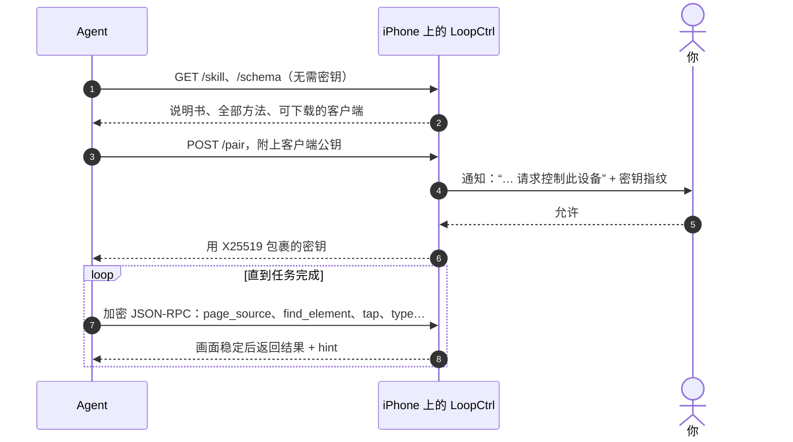

<p align="right"><a href="README.md">English</a> · <b>简体中文</b></p>

<p align="center">
  
</p>

<h1 align="center">LoopCtrl</h1>

<p align="center">
  <b>把一台 iPhone 交给你的 AI Agent。</b><br>
  手机自带说明书，谁来配对都要你点头，日常使用不需要 Mac。
</p>

<p align="center">
  <a href="#why">为什么选 LoopCtrl</a> ·
  <a href="#setup">装到手机上</a> ·
  <a href="#daily">日常使用</a> ·
  <a href="#clients">编写客户端</a> ·
  <a href="#build">从源码构建</a>
</p>

---

在手机上启动服务，然后对你的 Agent 说一句：

```text
我的 iPhone 上运行着 LoopCtrl，地址是 127.0.0.1:8300。先学会怎么操作它，然后打开“设置”告诉我 iOS 版本。
```

Agent 会先读手机提供的说明书，再从手机上下载客户端，然后发起配对。你在通知里点
**允许**，它就能看到屏幕，并在任何 App 里点击、滑动、输入，和你自己操作一样。

如果 Agent 就跑在这台手机上（比如 Minis），地址用 `127.0.0.1`。如果 Agent 在电脑上，
先打开 **远程访问**，再把 App 里显示的局域网地址交给它。

> [!CAUTION]
> **配对成功的客户端能控制整台手机**：所有 App、所有画面，以及你能输入的一切。只批准你自己
> 发起的配对请求，并核对手机上显示的密钥和客户端打印的是否一致。不用时关掉远程访问；涉及付款、
> 发消息或无法撤销的操作时，不要让 Agent 无人看管地运行。请只在自己的设备上使用，仅用于测试和研究。

<a id="why"></a>
## 为什么选 LoopCtrl

**1. Agent 能自己学会用。** 不用把 API 文档塞进提示词。手机本身就提供写给模型看的操作手册
（`GET /skill`）、包含全部方法的 schema（`GET /schema`），以及可以直接下载的客户端
（`GET /skill/clients/…`）。返回结果也是为 Agent 设计的：操作会等画面稳定后再返回，并在结果里说明；
结果里附带 `hint` 提示下一步怎么做；出错时会告诉它怎么恢复；元素 `ref` 遇到屏幕外的同名元素或长得相似的元素时会提醒。
`device_info` 会给出 `capabilities` 列表，客户端按能力判断功能，不必比较版本号。

**2. 全部在手机上运行。** 服务本身是手机上的一个 XCUITest runner。同一台手机上的 Agent
通过 `127.0.0.1` 访问，全程不需要电脑。安装和准备也可以都在手机上完成：用免费 Apple ID
通过 SideStore 安装；在本机配对（iOS 27 及以上）或导入配对文件；在 App 里借助隧道 App
（LocalDevVPN 或 Shadowrocket）挂载开发者磁盘镜像。Mac 不是必需的。

**3. 没有你点头，谁也连不上。** 默认只监听 `127.0.0.1`。每个客户端都要先申请配对，由你在手机上批准，
批准前可以核对密钥指纹，确认就是你要连的那个客户端。之后的每个请求都经过加密和认证，过期或被重放的请求会被拒绝。
你随时可以在 App 里吊销任何客户端。

**4. 只装一个 App。** 一体版把 App 和 runner 打进同一个 IPA，只占免费账号三个侧载名额中的一个。
启动、停止、再启动，全程都不用离开 LoopCtrl。

<a id="how"></a>
## 工作原理



LoopCtrl 的底层是一个长期运行的 XCUITest 会话，服务运行期间 iOS 会一直保持它。所以它能操作任何 App，
也因此必须先挂载开发者磁盘镜像。

<a id="setup"></a>
## 装到手机上

你需要一台 **iOS 16 及以上**、已开启 **开发者模式** 的 iPhone（设置 → 隐私与安全性 → 开发者模式，开启后重启）。

1. **准备 IPA。** 用 `make ipa-allinone UNSIGNED=1` 构建 `LoopCtrl-AllInOne.ipa`
   （见[从源码构建](#build)），或者用别人帮你构建好的包。
2. **签名并安装。** 免费 Apple ID 用 **最新版 SideStore**（My Apps → +）安装；付费开发者账号可以运行
   `Scripts/sign-ipa.sh -i LoopCtrl-AllInOne.ipa`，再安装生成的包。然后在
   设置 → 通用 → VPN 与设备管理 中信任证书。
3. **挂载磁盘镜像。** 打开 LoopCtrl，点 **挂载磁盘镜像**，App 会带你一步步完成：配对、下载镜像文件（只需一次）、
   连接 Wi-Fi、连接隧道 App、挂载。
4. **启动。** 点 **启动服务**。第一次启动时，iOS 会要求输入锁屏密码，并请求 **通知** 和 **本地网络** 权限。
   两个都要允许，因为批准客户端就是在通知里完成的。

现在把开头那句话交给你的 Agent 就行了。

> [!NOTE]
> **每次重启手机后**都要重新挂载磁盘镜像（第 3 步）。配对文件和已下载的镜像都会保留，点一下就好。

<details>
<summary><b>为什么不能随便找个签名工具？</b>以及其他签名安装方式</summary>

runner 里嵌着一个测试包 `PlugIns/LoopCtrlUITests.xctest`，必须先单独签名，而且要用宿主 App 的 bundle id。
跳过它的签名工具做出来的包，**一打开就闪退**。下面几种方式都处理好了这一点：

- **最新版 SideStore**（免费 Apple ID）。用 [iLoader](https://github.com/nab138/iLoader) 安装 SideStore，
  并保持 [LocalDevVPN](https://apps.apple.com/app/localdevvpn/id6755608044) 连接，SideStore 才能刷新签名。
  旧版 SideStore 用 `ldid` 签名，会跳过 `.xctest`。免费证书有效期 7 天，由 SideStore 负责续签。
- **`Scripts/sign-ipa.sh`**（付费账号，需要 Mac）。它会自动找到你的 team、覆盖该 bundle id 的开发描述文件和对应的证书
  （可用 `-t`、`-p`、`-s` 指定）。签名从内到外进行，逐个校验二进制，遇到发布用描述文件会直接拒绝。
  生成的包可以用 Xcode（Devices and Simulators）、Apple Configurator 或 `ideviceinstaller` 安装。
- **Xcode**（付费账号，需要 Mac）。运行 `make build`，打开 `LoopCtrl.xcodeproj`，选 **LoopCtrl** scheme，
  执行 **Product → Test**。Xcode 会顺便帮你挂载磁盘镜像。Xcode 断开后 runner 会继续运行。

</details>

<details>
<summary><b>挂载磁盘镜像</b>：App 需要什么，以及其他办法</summary>

在较新的 iOS 上，开发者服务只能通过隧道访问。隧道 App（LocalDevVPN；或 Shadowrocket，需在
设置 → 其他 中打开 “Include Route 10.7.0.1/32”）只是把一个私有地址反射回手机本身，不会接管其他流量。
LoopCtrl 的挂载功能基于 [idevice](https://github.com/jkcoxson/idevice)。

- **配对。** iOS 27 及以上：点 **在本机配对**，然后进入 设置 → 隐私与安全性 → 开发者模式 →
  “Pair with LoopCtrl”，输入 App 显示的配对码。更早的系统：**导入配对文件**，可以用 StikPair 生成的文件，
  或 iLoader 在 iOS 17.4 及以上导出的文件。只用 `idevicepair` 生成的文件无法挂载。
- **网络。** 任意 Wi-Fi 都可以，只有蜂窝网络不行。第一次挂载需要联网，因为 Apple 要为这台设备单独签发镜像。
- **其他办法。** 连接 Mac 上的 Xcode 会自动挂载，[StikDebug](https://github.com/StikDebug/StikDebug) 也可以。

</details>

<details>
<summary><b>遇到问题</b></summary>

- **runner 一打开就退出。** 可能是磁盘镜像没挂载（常见于重启之后）、`.xctest` 没签名，或者免费证书过期了。
- **电脑连不上。** 可能是远程访问没开、本地网络权限被拒绝，或者手机只连着蜂窝网络。可以用
  `curl http://<手机IP>:8300/schema` 测试。
- **客户端说正在配对，手机上却没有弹窗。** 说明网络上有别的设备冒充了你的手机，不要信任它。

</details>

<a id="daily"></a>
## 日常使用

**主屏幕** 显示当前状态（配对、磁盘镜像、服务），并且只放一个按钮引导下一步：挂载、启动或停止。
服务运行时还会显示服务地址（点一下即可复制）和 **远程访问** 开关。

**设置** 里可以配对和挂载、修改端口、查看并吊销已授权客户端、看 runner 和 App 的日志，
还能看到服务的版本和能力。

**通知** 让你在别的 App 里也能操作。长按服务通知，可以开关远程访问、近场发现，或停止服务；
长按授权请求，可以允许或拒绝。批准时手机需要处于解锁状态。

**谁能连进来。** 访问范围一级一级放开，每一级都要你在手机上操作：

| | 谁能申请配对 |
|---|---|
| 默认 | 本机上的 App，以及通过 USB 连接的电脑 |
| 打开 **远程访问** | 同一 Wi-Fi 下知道地址的任何设备 |
| 再打开 **近场发现** | 附近的 Mac 也可以，不需要同一个网络（点对点 Wi-Fi）；手机会主动广播自己 |

无论哪一级，每个客户端都还要你点 **允许**。近场发现只能在手机上打开。打开后，客户端连地址都不需要：
先运行 `python3 loopctrl_rpc.py scan`，再用 `--nearby "<名称或 id>"` 连接。

**端口。** 默认是 **8300**。服务停止时可以在设置里修改（1024–65534）；近场发现会占用它的下一个端口。
不要和 iCTRL 等其他自动化 App 使用同一个端口，两个 runner 抢同一个端口会互相干扰。

> [!NOTE]
> **已知问题。** 在一体版里停止服务后，iOS 的 “Automation Running” 浮层要等 LoopCtrl 退出才会消失。
> 我们正在排查；在修复之前，可以在多任务界面划掉 LoopCtrl 来清除它。

<a id="clients"></a>
## 编写客户端

每个 `/rpc` 请求都装在加密信封里，没有明文模式。建议直接从手机提供的客户端起步：

| 客户端 | 下载地址 | 适用场景 |
|---|---|---|
| Python，[`Scripts/loopctrl_rpc.py`](Scripts/loopctrl_rpc.py) | `/skill/clients/python` | 任何系统。只依赖标准库；通过 Wi-Fi 配对时还需要 `cryptography`。自带 `scan` 和 `--nearby`。 |
| 静态 CLI，[`cli/`](cli/) | `/skill/clients/cli` + `/skill/clients/cli.sh` | 没有解释器的沙盒环境。`aarch64-linux-musl`，无任何依赖；用 `sh loopctrl.sh …` 运行。 |

```bash
curl -o loopctrl_rpc.py http://<手机>:8300/skill/clients/python
python3 loopctrl_rpc.py --host <手机>:8300 pair              # 在手机上点“允许”
python3 loopctrl_rpc.py --host <手机>:8300 call device_info
python3 loopctrl_rpc.py --host <手机>:8300 call find_element '{"element_id":"Wi-Fi"}'
```

密钥按设备保存在 `~/.loopctrl/token.json`，两个客户端共用这个文件。配对一次之后，USB、Wi-Fi、近场都能用。
密钥 30 天没有使用就会失效。

**方法**（JSON-RPC 2.0，走 `POST /rpc`；全部参数见 `GET /schema`）：

- **看**：`page_source`、`find_element`、`screen_text`（设备端 OCR）、`screenshot`、`collect`
- **点和滑**：`tap`、`double_tap`、`long_press`、`tap_element`、`find_and_tap`、`swipe`、`scroll`、`scroll_to_element`、`page`、`drag`
- **输入**：`type`、`clear_text`
- **App**：`resolve_app`、`launch_app`、`activate_app`、`terminate_app`、`list_apps`、`open_url`
- **设备**：`device_info`、`home`、`lock`、`unlock`、`is_locked`、`wait`
- **服务**：`config`、`logs`、`reset`、`stream_ticket`

**普通 HTTP**：`/skill`、`/schema`、`/whoami`、`/docs` 和 `/pair` 无需密钥。`/remote` 是浏览器控制页，
可以添加到主屏幕，真正控制前会要求填入密钥。`/stream`（实时 H.264）和 `/logs` 需要先用 `stream_ticket`
换一张一次性票据。

<details>
<summary><b>配对与加密信封协议</b></summary>

- `POST /pair` 最多等待 60 秒，等用户点允许。走网络时，客户端发送 X25519 公钥，32 字节密钥 `K` 以包裹形式返回：
  `K = token_ct XOR HMAC(HMAC(X25519(c_priv, d_pub), "loopctrl-pair" || c_pub || d_pub), "loopctrl-wrap")`。
  仅限来自 `127.0.0.1` 的请求，可以发送 `{"client_name": "…", "plain": true}` 直接拿到 `K`。
- 每个请求用从 `K` 派生的 HMAC-SHA256 密钥加一个新的 nonce 封装。重放的请求会被拒绝，时间戳偏差超过 ±120 秒的也会被拒绝。
- 同一时间只有一个配对请求在等待，被拒绝后有冷却时间。来自手机本身的请求有独立的名额。
- 密钥存在 App 的沙盒里，而不是钥匙串，所以重新签名不会让它失效。

参考实现见 `Scripts/loopctrl_rpc.py` 和 `cli/main.c`。

</details>

<a id="build"></a>
## 从源码构建

需要 macOS、Xcode（登录任意 Apple ID 即可）、XcodeGen 和 Rust：

```bash
brew install xcodegen
rustup target add aarch64-apple-ios
make ipa-allinone            # → LoopCtrl-AllInOne.ipa（一个 App）
make ipa                     # → LoopCtrl.ipa + LoopCtrlUITests-Runner.ipa（两个 App）
```

- 加上 `UNSIGNED=1` 可以跳过 Xcode 签名，改用 ad-hoc 签名（bundle 前缀为 `com.openminis`）。
  适合反正要交给 SideStore 或 `sign-ipa.sh` 重新签名的包。
- 分享构建好的 IPA 之前，先用 `Scripts/package-release.sh` 去掉里面的描述文件（含你的姓名、team 和设备 UDID）。
- 第一次运行 `make` 时，会从源码构建 idevice 框架（要几分钟，只需一次），还会生成包含你的 team 和 bundle 前缀的
  `Config/Local.xcconfig`，并根据 `project.yml` 生成 Xcode 工程。签名设置请改在这些文件里，不要在 Xcode 里改。
- **双 IPA 版** 把 App 和 runner 分开安装，App 通过 `loopctrl://` URL scheme 启动 runner。它占两个侧载名额，
  在 App 里切换远程访问需要点一次允许。一体版如何在进程内加载 runner，见
  [`docs/runner-merge-spike.md`](docs/runner-merge-spike.md)。
- **CLI** 单独构建，需要 Docker 或 `zig`：`make -C cli build`、`make -C cli test`，或用 `make -C cli macos`
  构建支持近场发现的 macOS 客户端。`cli/loopctrl` 已提交进仓库，因为 runner 会内置它；修改 `cli/main.c`
  或协议后记得重新构建。

| 目录 | 内容 |
|---|---|
| `LoopCtrlApp/` | SwiftUI App：主屏幕、设置、配对与磁盘镜像挂载（`DDI/`）、进程内 runner（`Runner/`） |
| `LoopCtrlUITests/` | 自动化引擎：runner、各类操作的处理、多语言文案 |
| `LoopCtrlKit/` | 两者共用：HTTP 服务、配对与加密信封、方法注册表 |
| `cli/`、`Scripts/` | 客户端，以及签名和打包脚本 |
| `SKILL.md` | 手机在 `/skill` 提供的说明书 |

## 局限

- 用到了 XCTest 和系统的私有 API，不能上 App Store，未来的 iOS 版本也可能让部分功能失效。较新的 iOS
  已经拒绝返回完整的 App 列表，`list_apps` 会退而返回 LoopCtrl 打开过的 App。找 App 请用 `resolve_app` 和 `launch_app`。
- `unlock` 只能点亮屏幕，不能输入锁屏密码。长时间无人值守运行时，把自动锁定设为“永不”。熄屏不会让服务停止。
- 带有机器人检测的 App 仍然可能识别出自动化操作。
- 无需密钥的接口通过近场也能访问；屏幕视频流在任何通道上都不加密。
- 如果旧版 runner 留下了很大的“系统数据”，可以通过 USB 连接后运行 `Scripts/clean-xctest-attachments.sh`
  查看，确认后加 `--delete` 清理。

## 许可证

Apache License 2.0，见 [`LICENSE`](LICENSE)。第三方组件和早期 AGPL-3.0 版本的说明见 [`NOTICE.md`](NOTICE.md)。

LoopCtrl 最初 fork 自 iCTRL。配对和挂载基于 [idevice](https://github.com/jkcoxson/idevice)（MIT）；
隧道部分通过 [LocalDevVPN](https://github.com/jkcoxson/LocalDevVPN) 作为独立 App 调用；磁盘镜像在运行时从
[doronz88/DeveloperDiskImage](https://github.com/doronz88/DeveloperDiskImage) 下载。设备端挂载的思路来自
[StikDebug](https://github.com/StikDebug/StikDebug)，长期运行的 XCUITest runner 最早由
[WebDriverAgent](https://github.com/appium/WebDriverAgent) 实现。LoopCtrl 没有复制这两个项目的任何代码。
