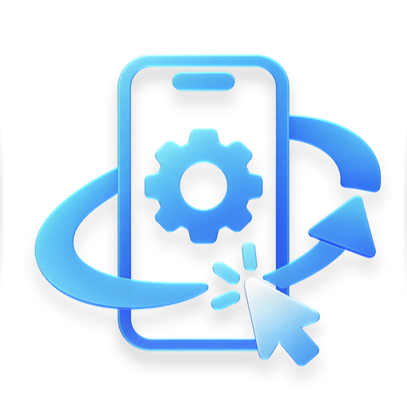
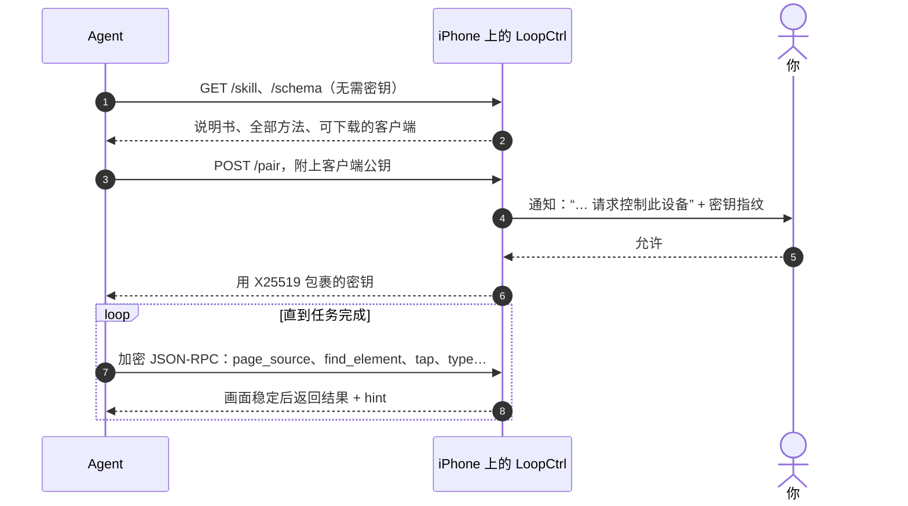

<p align="right"><a href="README.md">English</a> · <b>简体中文</b></p>

<p align="center">
  
</p>

<h1 align="center">LoopCtrl</h1>

<p align="center">
  <b>把一台 iPhone 交给你的 AI Agent。</b><br>
  手机自带说明书，谁来配对都要你点头，日常使用不需要 Mac。
</p>

<p align="center">
  <a href="#install">安装</a> ·
  <a href="#requirements">系统要求</a> ·
  <a href="#approval">配对审批</a> ·
  <a href="#access">访问方式</a> ·
  <a href="#developers">Agent 与开发者</a> ·
  <a href="#security">安全模型</a> ·
  <a href="#limits">已知局限</a>
</p>

---

在手机上启动服务，然后对你的 Agent 说一句：

```text
我的 iPhone 上运行着 LoopCtrl，地址是 127.0.0.1:8300。先学会怎么操作它，然后打开“设置”告诉我 iOS 版本。
```

Agent 会先读手机提供的说明书，再从手机上下载客户端，然后发起配对。你在通知里点
**允许**，它就能看到屏幕，并在任何 App 里点击、滑动、输入，和你自己操作一样。

如果 Agent 就跑在这台手机上（比如 Minis），地址用 `127.0.0.1`。如果 Agent 在同一 Wi-Fi 下的电脑上，
先打开 **局域网访问**，再把 App 里显示的地址交给它。在别的网络里，可以通过[远程服务](#remote)
或 [Tailnet 组网](#tailnet)连接。

> [!CAUTION]
> **配对成功的客户端能控制整台手机**：所有 App、所有画面，以及你能输入的一切。只批准你自己
> 发起的配对请求，并核对手机上显示的密钥指纹和客户端打印的是否一致。不用时关掉局域网访问和远程连接；
> 涉及付款、发消息或无法撤销的操作时，不要让 Agent 无人看管地运行。请只在自己的设备上使用，仅用于测试和研究。

## 它能做什么

- **Agent 能自己学会用。** 手机本身就提供写给模型看的操作手册（`GET /skill`）、包含全部方法的
  schema（`GET /schema`），以及可以直接下载的客户端（`GET /skill/clients/…`）。操作会等画面稳定后再返回，
  结果里附带 `hint` 提示下一步；出错时会告诉它怎么恢复。
- **全部在手机上运行。** 服务本身是手机上一个长期运行的 XCUITest runner，同一台手机上的 Agent 通过
  `127.0.0.1` 访问。开发者磁盘镜像由 App 自己挂载，所以手机重启后点一下就好，不需要电脑。
- **没有你点头，谁也连不上。** 每个客户端都要申请配对，由你核对密钥指纹后在手机上批准。之后的每个请求都经过加密和认证。
  你随时可以吊销任何客户端。
- **只装一个 App。** 自动化 runner 就在 LoopCtrl 里面，只占免费 Apple ID 三个侧载名额中的一个，启动和停止都不用离开 App。



<a id="install"></a>
## 安装

1. **下载 `LoopCtrl.ipa`**，在 [Releases](https://github.com/Souitou-iop/LoopCtrl/releases) 里，
   旁边的 `SHA256SUMS.txt` 是它的校验值。包本身没有签名：
   不含描述文件、team id 和任何设备标识。
2. **签名并安装。** 免费 Apple ID 用 **最新版 SideStore**（My Apps → +）安装；有付费账号和 Mac 的话，运行
   `Scripts/sign-ipa.sh -i LoopCtrl.ipa`，再安装生成的包。然后在 设置 → 通用 → VPN 与设备管理
   中信任证书，并打开 **开发者模式**（设置 → 隐私与安全性 → 开发者模式，开启后重启）。
3. **配对一次。** iOS 27 及以上直接在手机上配对。iOS 27 以下，用数据线连一次
   [LoopCtrl Pair](https://github.com/Souitou-iop/LoopCtrl-Pair)，或者导入配对文件。见[系统要求](#requirements)。
4. **挂载磁盘镜像。** 连上 LocalDevVPN 或 Shadowrocket，打开 LoopCtrl，点 **挂载磁盘镜像**，App 会带你一步步完成。
5. **启动。** 点 **启动服务**。第一次启动时，iOS 会要求输入锁屏密码，并请求 **通知** 和 **本地网络** 权限。
   两个都要允许，因为批准客户端就是在通知里完成的。

现在把开头那句话交给你的 Agent 就行了。

> [!NOTE]
> **每次重启手机后**都要重新挂载磁盘镜像（第 4 步）。配对文件和已下载的镜像都会保留，点一下就好。

<details>
<summary><b>为什么不能随便找个签名工具？</b>以及其他签名安装方式</summary>

runner 里嵌着一个测试包 `PlugIns/LoopCtrlUITests.xctest`，必须先单独签名，而且要用宿主 App 的 bundle id。
跳过它的签名工具做出来的包，**一打开就闪退**。下面几种方式都处理好了这一点：

- **SideStore 最新版**（免费 Apple ID）。用 [iLoader](https://github.com/nab138/iLoader) 安装 SideStore，
  并保持 [LocalDevVPN](https://apps.apple.com/app/localdevvpn/id6755608044) 连接，SideStore 才能刷新 App。
  旧版 SideStore 用 `ldid` 签名，会跳过 `.xctest`。免费证书 7 天过期，SideStore 会自动续签。
- **`Scripts/sign-ipa.sh`**（付费账号，需要 Mac）。它会自己找到你的 team、覆盖该 bundle id 的开发描述文件和对应的签名身份
  （可以用 `-t`、`-p`、`-s` 手动指定）。它从里到外逐层签名，校验每个二进制文件，并拒绝发布用描述文件。生成的包可以用
  Xcode（设备与模拟器）、Apple Configurator 或 `ideviceinstaller` 安装。

</details>

<details>
<summary><b>遇到问题</b></summary>

- **runner 一打开就关闭。** 磁盘镜像没有挂载（常见于重启之后）、`.xctest` 没有签名，或者免费证书过期了。
- **电脑连不上。** 没开局域网访问、拒绝了本地网络权限，或者手机只连着蜂窝网络。可以用
  `curl http://<手机 IP>:8300/schema` 测试。
- **客户端说正在配对，手机上却没有弹窗。** 说明网络里有别的东西冒充了它。不要信任它。

</details>

<a id="requirements"></a>
## 系统要求（按 iOS 版本）

App 在 **iOS 16 及以上**都能运行。不同版本的区别在于怎么配对，以及 App 挂载哪种开发者磁盘镜像：

| iOS | 配对 | 在手机上挂载的磁盘镜像 |
|---|---|---|
| 16 | 用数据线连一次：[LoopCtrl Pair](https://github.com/Souitou-iop/LoopCtrl-Pair)，或导入 lockdown 配对文件（`idevicepair`、jitterbugpair、iLoader） | 旧式 `DeveloperDiskImage.dmg`，经 lockdownd 挂载（[说明](docs/ios16-ddi-mount.md)） |
| 17.0–17.3 | 暂不支持在手机上完成（见[已知局限](#limits)） | 请改用 Xcode 挂载 |
| 17.4–26.3 | 用数据线连一次：LoopCtrl Pair，或导入 iLoader 导出的配对文件 | 个性化镜像（Personalized） |
| 26.4–26.x | 用数据线连一次：LoopCtrl Pair，或导入 iLoader 导出的配对文件 | Cryptex 镜像 |
| 27 及以上 | **在手机上完成**：点 **在本机配对**，然后到 设置 → 隐私与安全性 → 开发者模式 → “Pair with LoopCtrl”，输入 App 显示的配对码 | Cryptex 镜像 |

所有版本都需要：

- **隧道 App**，用于回环：[LocalDevVPN](https://apps.apple.com/app/localdevvpn/id6755608044)，或者 Shadowrocket
  （在 设置 → 其他 中打开 “Include Route 10.7.0.1/32”）。它只是把一个私有地址回送给手机，不转发其他任何流量。
- **Wi-Fi。** 任意网络都行，只有蜂窝网络不行。
- **磁盘镜像** 只需下载一次，来自 [doronz88/DeveloperDiskImage](https://github.com/doronz88/DeveloperDiskImage)
  的一个固定 commit：先走 jsDelivr，失败再走 GitHub。无论从哪里下载，每个文件都要和固定的 SHA-256 一致。
  iOS 17 及以上第一次挂载还需要联网，因为 Apple 要为你的设备单独签名镜像。
- **LoopCtrl Pair** 支持 Windows、macOS、Linux 和 Android（需要 USB OTG）。它会处理“信任此电脑”和开发者模式，
  生成你的 iOS 版本需要的配对记录，写进 LoopCtrl 并校验。单靠 `idevicepair` 生成的文件在 iOS 17 及以上无法挂载：
  这些版本需要 RemotePairing 记录。

LoopCtrl 的挂载功能基于 [idevice](https://github.com/jkcoxson/idevice)。把手机连到 Mac 上的 Xcode 也会挂载镜像。

<a id="approval"></a>
## 配对审批

无论从哪条路连进来，每个新客户端都要你在手机上点 **允许**。批准时手机需要处于解锁状态。

- **通知** 会显示客户端名称、来源（本机、USB、局域网、近场、Tailnet、VPN、中继……）和密钥指纹。
  长按通知可以允许或拒绝。划掉通知不等于拒绝，请求会继续等待。
- **主屏幕卡片。** 请求等待期间，主屏幕会显示一张卡片，内容和通知一样，另有倒计时和“允许”“拒绝”按钮。
  卡片会一直留着，直到请求被处理或超时（60 秒）。
- **事后允许。** 错过了也没关系：被拒绝或超时的请求会在最近列表里保留 10 分钟。在那里点 **允许此客户端**，
  这个客户端下次重试时就会直接通过，不再弹窗。这次授权绑定的是客户端公钥完整的 SHA-256，而不是名称或短指纹，
  并且只能用一次。参考客户端会把待定的密钥保留 10 分钟，保证重试时用的是同一把。
- **授权管理页**（主屏幕上的 **已授权 N 个客户端**，或在设置里进入）：等待中的请求、最近 10 分钟的请求及结果，
  以及所有持有密钥的客户端，包括它从哪里连接、最后活跃时间。左滑吊销单个，或全部吊销。

详见 [docs/pairing-approval.md](docs/pairing-approval.md)。

<a id="access"></a>
## 访问方式

默认只监听 `127.0.0.1`。下面每一级都会扩大“谁能**申请**配对”的范围，但每个客户端仍然要你点允许。

| | 谁能申请配对 |
|---|---|
| 默认 | 本机上的 App，以及通过 USB 连接的电脑 |
| 打开 **局域网访问** | 同一 Wi-Fi 下知道地址的任何设备 |
| **局域网 + 近场** | 附近的 Apple 设备也可以，不需要同一个网络（AWDL）；手机会主动广播自己 |
| **远程服务** | 你接受的邀请里列出的操作员，经由中继 |
| **Tailnet 组网** | 你的 Tailscale 或 Headscale 网络里的设备（需打开局域网访问） |

### 局域网访问

在主屏幕或服务通知里打开。主屏幕会显示服务地址（点一下即可复制）。默认端口是 **8300**，可以在设置里改
（1024–65534），服务会在新端口上重启。近场发现会占用它的下一个端口。不要和其他自动化 App 使用同一个端口，
两个 runner 抢同一个端口会互相干扰。

近场发现只能在手机上打开。打开后，客户端连地址都不需要：先运行 `python3 loopctrl_rpc.py scan`，
再用 `--nearby "<名称或 id>"` 连接。

<a id="remote"></a>
### 远程服务

主屏幕上的 **远程服务** 让手机连到一个中继，这样另一个网络里的操作员也能访问它。添加连接有几种方式：

- **邀请链接**（`loopctrl://connect?…`），粘贴或直接打开；
- **二维码**，用相机扫描，或从相册选择；
- **手动输入** 服务器地址和连接码。

**确认连接** 页面会显示服务器、连接是否加密、证书是否已固定、邀请里列出的操作员，以及他们能做什么。
如果邀请列出了操作员，App 会和服务器返回的结果核对，不一致就拒绝连接。确认后，**只预先授权这些操作员的密钥**，
而且只对经过这个中继的请求生效。没有列出操作员的邀请（手动输入、文字形式）不会预先授权任何人：你需要自己核对指纹，
每个操作员第一次连接时都会像普通客户端一样询问你。

在连接详情页可以 **断开**（保留绑定，之后再连）或 **解除绑定**（中继会忘掉这台手机）。这里还能看到谁正在操作、
最近操作记录和中继的证书。

中继是 **不受信任的**：它只转发端到端加密的信封，配对和每个请求都只在操作员的客户端和手机之间解开。
手机自己的凭据是一把 Ed25519 密钥，保存在它的钥匙串里。**App 里没有内置服务器**：可以使用服务商提供的服务，
也可以自己部署（见[自行部署](#self-hosting)）。协议和接入 API 见 [docs/relay-enrollment.md](docs/relay-enrollment.md)。

<a id="tailnet"></a>
### Tailscale 与 Headscale

Tailnet 组网是另一种连接方式。让手机加入 Tailscale 或 Headscale 网络，打开局域网访问，再把手机的 Tailnet 地址
（`100.x.y.z`）交给 Agent。来自 Tailnet 地址（100.64.0.0/10 和 fd7a:115c:a1e0::/48）的请求，会在审批提示和授权管理页里标为
Tailnet 来源，并且一律按远程处理，不会被当成本机。Shadowrocket 可以同时运行 Tailnet 节点和回环路由，省去在两个 VPN 之间来回切换。

<a id="self-hosting"></a>
## 自行部署

参考中继和 Headscale 部署配置在 [LoopCtrl-Server](https://github.com/Souitou-iop/LoopCtrl-Server)。
也可以按照 [docs/relay-enrollment.md](docs/relay-enrollment.md) 自己实现中继 API。

<a id="developers"></a>
## Agent 与开发者

### API

JSON-RPC 2.0，走 `POST /rpc`，装在加密信封里，没有明文模式。`GET /schema` 列出全部方法和参数，
[`SKILL.md`](SKILL.md) 就是手机在 `GET /skill` 提供的说明书。

- **看**：`page_source`、`find_element`、`screen_text`（设备端 OCR）、`screenshot`、`collect`
- **点和滑**：`tap`、`double_tap`、`long_press`、`tap_element`、`find_and_tap`、`swipe`、`scroll`、`scroll_to_element`、`page`、`drag`
- **输入**：`type`、`clear_text`
- **App**：`resolve_app`、`launch_app`、`activate_app`、`terminate_app`、`list_apps`、`open_url`
- **设备**：`device_info`、`home`、`lock`、`unlock`、`is_locked`、`wait`
- **服务**：`config`、`logs`、`reset`、`stream_ticket`

`device_info` 会给出 `capabilities` 列表，客户端按能力判断功能，不必比较版本号。普通 HTTP：`/skill`、`/schema`、
`/whoami`、`/docs` 和 `/pair` 无需密钥。`/remote` 是浏览器控制页，真正控制前会要求填入密钥。`/stream`（实时 H.264）
和 `/logs` 需要先用 `stream_ticket` 换一张一次性票据。

### 客户端

| 客户端 | 下载地址 | 适用场景 |
|---|---|---|
| Python，[`Scripts/loopctrl_rpc.py`](Scripts/loopctrl_rpc.py) | `/skill/clients/python` | 任何系统。只依赖标准库；通过网络配对时还需要 `cryptography`。自带 `scan` 和 `--nearby`。 |
| 静态 CLI，[`cli/`](cli/) | `/skill/clients/cli` + `/skill/clients/cli.sh` | 没有解释器的沙盒环境。`aarch64-linux-musl`，无任何依赖；用 `sh loopctrl.sh …` 运行。 |

```bash
curl -o loopctrl_rpc.py http://<手机>:8300/skill/clients/python
python3 loopctrl_rpc.py --host <手机>:8300 pair              # 在手机上点“允许”
python3 loopctrl_rpc.py --host <手机>:8300 call device_info
python3 loopctrl_rpc.py --host <手机>:8300 call find_element '{"element_id":"Wi-Fi"}'
```

密钥按设备保存在 `~/.loopctrl/token.json`，两个客户端共用这个文件，所以配对一次之后，USB、Wi-Fi、近场都能用。
密钥 30 天没有使用就会失效。

<details>
<summary><b>配对与加密信封协议</b></summary>

- `POST /pair` 最多等待 60 秒，等用户点允许。走网络时，客户端发送 X25519 公钥，32 字节密钥 `K` 以包裹形式返回：
  `K = token_ct XOR HMAC(HMAC(X25519(c_priv, d_pub), "loopctrl-pair" || c_pub || d_pub), "loopctrl-wrap")`。
  仅限来自 `127.0.0.1` 的请求，可以发送 `{"client_name": "…", "plain": true}` 直接拿到 `K`。
- 每个请求用从 `K` 派生的 HMAC-SHA256 密钥加一个新的 nonce 封装。重放的请求会被拒绝，时间戳偏差超过 ±120 秒的也会被拒绝。
- 同一时间只有一个配对请求在等待，被拒绝后有冷却时间。来自手机本身的请求有独立的名额。
- 密钥存在 App 的沙盒里，而不是钥匙串，所以重新签名不会让它失效。

参考实现见 `Scripts/loopctrl_rpc.py` 和 `cli/main.c`。

</details>

### 研究笔记

[`docs/research/`](docs/research/) 里是说明书背后的测量和设计：[操控速度与准确率](docs/research/control-speed-accuracy.md)、
[跨 App 操作手册设计](docs/research/operation-playbook-design.md)、[App 知识如何积累和维护](docs/research/app-knowledge-workflow.md)，
以及 [SKILL.md A/B 测试](docs/research/skill-ab-test.md)（测试工具在 [`tools/skill-ab/`](tools/skill-ab/)）。

<a id="build"></a>
### 从源码构建

需要 macOS、Xcode（登录任意 Apple ID 即可）、XcodeGen 和 Rust：

```bash
brew install xcodegen
rustup target add aarch64-apple-ios
make ipa                     # → LoopCtrl.ipa
```

- 加上 `UNSIGNED=1` 可以跳过 Xcode 签名，改用 ad-hoc 签名（bundle 前缀为 `com.openminis`）。
  适合反正要交给 SideStore 或 `sign-ipa.sh` 重新签名的包。
- 分享 `LoopCtrl.ipa` 之前，先用 `Scripts/package-release.sh` 去掉里面的描述文件（含你的姓名、team 和设备 UDID）。
  正式发布由 [`.github/workflows/release.yml`](.github/workflows/release.yml) 构建。
- 第一次运行 `make` 时，会从源码构建 idevice 框架（要几分钟，只需一次），还会生成包含你的 team 和 bundle 前缀的
  `Config/Local.xcconfig`，并根据 `project.yml` 生成 Xcode 工程。签名设置请改在这些文件里，不要在 Xcode 里改。
- LoopCtrl 如何在进程内加载 runner，见 [`docs/runner-merge-spike.md`](docs/runner-merge-spike.md)。
- **旧的双 App 构建** 仍然保留，作为备用：`make ipa-twoapp` 会生成 `LoopCtrl-TwoApp.ipa` 和 `LoopCtrlUITests-Runner.ipa`，
  把 App 和 runner 分成两个 App（`Scripts/package-release.sh --two-app` 可以一起处理）。它占两个侧载名额，也不支持远程连接。
  有付费账号的话，还可以用 Xcode 运行这个 runner：`make build`，打开 `LoopCtrl.xcodeproj`，选择 **LoopCtrl** scheme，
  执行 **Product → Test**。
- **CLI** 单独构建，需要 Docker 或 `zig`：`make -C cli build`、`make -C cli test`，或用 `make -C cli macos`
  构建支持近场发现的 macOS 客户端。`cli/loopctrl` 已提交进仓库，因为 runner 会内置它；修改 `cli/main.c`
  或协议后记得重新构建。

| 目录 | 内容 |
|---|---|
| `LoopCtrlApp/` | SwiftUI App：主屏幕、设置、远程服务、配对与磁盘镜像挂载（`DDI/`）、进程内 runner（`Runner/`） |
| `LoopCtrlUITests/` | 自动化引擎：runner、各类操作的处理、多语言文案 |
| `LoopCtrlKit/` | 两者共用：HTTP 服务、配对与加密信封、方法注册表、邀请解析 |
| `cli/`、`Scripts/` | 客户端，以及签名和打包脚本 |
| `SKILL.md` | 手机在 `/skill` 提供的说明书 |

<a id="security"></a>
## 安全模型

- 在你放开访问之前，服务只监听 `127.0.0.1`；每放开一级，都要在手机上手动打开。
- 每个客户端都用 X25519 密钥配对，并且要你在手机上点允许。密钥指纹让你确认它就是你要连的那个客户端。
- 每个 `/rpc` 请求都用该客户端独有的密钥加密和认证；重放和过期时间戳会被拒绝。密钥 30 天不用就失效，也可以随时吊销。
- 预先授权的范围很窄：事后允许只能用一次，并绑定一把公钥；远程邀请只预先授权它列出的密钥，而且只对经过该中继的请求生效。
- 中继不受信任，只能看到封好的信封。
- 不在保护范围内：无需密钥的接口和屏幕视频流，在任何通道上都不加密。

<a id="limits"></a>
## 已知局限

- 用到了 XCTest 和系统的私有 API，不能上 App Store，未来的 iOS 版本也可能让部分功能失效。较新的 iOS
  已经拒绝返回完整的 App 列表，`list_apps` 会退而返回 LoopCtrl 打开过的 App；找 App 请用 `resolve_app` 和 `launch_app`。
- **iOS 16** 尚未在真机上验证：旧式挂载已经写好，并对照 idevice 源码检查过，但进程内 XCTest 启动在 iOS 16 上能否成功还没有测过。
- **iOS 17.0–17.3**：手机上的挂载需要 RemotePairing 记录，而这几个版本无法只靠 USB 生成。请改用 Xcode 挂载。
- **LoopCtrl Pair → LoopCtrl**：LoopCtrl 还不会自动读取 LoopCtrl Pair 写进来的配对文件，这部分还在开发中。
  在那之前，请在设置里导入配对文件。
- **“Automation Running” 浮层** 在服务运行时会显示。点停止会交还自动化权限，浮层随之消失；再次启动时重新接管
  （iOS 可能要求输入锁屏密码）。如果 iOS 不肯交还，服务日志里会写明，浮层会一直留到 LoopCtrl 退出：在多任务界面划掉它即可。
- `unlock` 只能点亮屏幕，不能输入锁屏密码。长时间无人值守运行时，把自动锁定设为“永不”。熄屏不会让服务停止。
- 带有机器人检测的 App 仍然可能识别出自动化操作。
- 如果旧版 runner 留下了很大的“系统数据”，可以通过 USB 连接后运行 `Scripts/clean-xctest-attachments.sh`
  查看，确认后加 `--delete` 清理。

## 许可证

Apache License 2.0，见 [`LICENSE`](LICENSE)。第三方组件和早期 AGPL-3.0 版本的说明见 [`NOTICE.md`](NOTICE.md)。

LoopCtrl 最初 fork 自 iCTRL。配对和挂载基于 [idevice](https://github.com/jkcoxson/idevice)（MIT）；
隧道部分通过 [LocalDevVPN](https://github.com/jkcoxson/LocalDevVPN) 作为独立 App 调用；磁盘镜像在运行时从
[doronz88/DeveloperDiskImage](https://github.com/doronz88/DeveloperDiskImage) 下载。设备端挂载的思路来自
[StikDebug](https://github.com/StikDebug/StikDebug)，长期运行的 XCUITest runner 最早由
[WebDriverAgent](https://github.com/appium/WebDriverAgent) 实现。LoopCtrl 没有复制这两个项目的任何代码。
