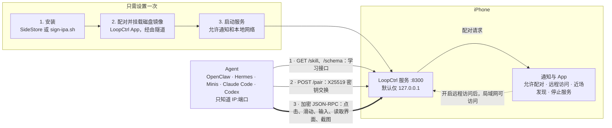

<p align="right"><a href="README.md">English</a> | <b>简体中文</b></p>

<p align="center"></p>

<h1 align="center">LoopCtrl</h1>

<p align="center"><b>把 iPhone 交给 AI Agent 操作：基于 XCUITest 的加密 JSON-RPC 自动化服务。</b></p>

> [!WARNING]
> **仅用于自动化测试和研究。** LoopCtrl 会把整部手机（点击、文字输入、屏幕内容、
> 所有已安装的 App）的控制权交给持有配对密钥的一方。这类自动化都可能被劫持或滥用：
> 密钥泄露、批准了不该批准的客户端，或者 Agent 照着途中读到的指令行事。
> **使用前请先权衡风险：**
> - 只在你自己的设备、你有权自动化的账号上使用。
> - 只批准你自己发起的配对请求。
> - 不需要时保持远程访问关闭，用完就停止服务。
> - 涉及支付、消息或任何无法撤销的操作时，不要让 Agent 无人看管。
>
> 使用方式由你自己负责，包括遵守你所自动化的 App 的服务条款。

## 它是什么

LoopCtrl 在 iPhone 上运行一个常驻的 XCUITest runner。Runner 提供**基于 HTTP 的
JSON-RPC 2.0 接口**，所有请求都经过加密，AI Agent（或任何 HTTP 客户端）可以点击、
滑动、输入文字、读取界面树、截图、启动 App、打开链接等。

它是为**让模型自己发现并使用**而设计的：设备在 `GET /skill` 提供完整的操作手册，
在 `GET /schema` 提供所有方法及其参数，所以 Agent 只要知道地址，就能在运行时学会
这套接口。任何能发 HTTP 请求的 Agent 都可以使用，例如 OpenClaw、Hermes、Minis、
Claude Code、Codex。

服务启动后（如果 Agent 不在手机上，需要先开启远程访问），对你的 Agent 说一句：

> *“我的 iPhone 上运行着 LoopCtrl，地址是 192.168.1.20:8300，你自己想办法操作它。”*

它会读取手册，从设备上下载客户端，然后发起配对。你在手机上批准后，剩下的它自己搞定。



手机上的 Agent（例如 Minis）通过 `127.0.0.1` 访问服务。其他电脑上的 Agent 需要开启
**远程访问**，并且和手机在同一个 Wi-Fi 下。

| | |
|---|---|
| **Bundle ID** | `com.openminis.loopctrl`（双 IPA 版本中，runner 为 `com.openminis.loopctrl.uitests`；自行从源码构建时使用你自己的前缀，见[构建](#构建)） |
| **传输** | 基于 HTTP 的 JSON-RPC 2.0。默认端口 **8300**，可在 App 中修改（设置 → 端口）。近场发现使用其后一个端口（8301）。 |
| **认证** | 加密信封：X25519 配对，之后每个请求用 HMAC-SHA256 封装 |
| **需要** | iOS 16 或更高；一种签名安装 IPA 的方式（免费 Apple ID 搭配 SideStore，或付费开发者账号）；已挂载开发者磁盘镜像 |

> **默认端口是 8300，不是 8200。** 默认值从 iCTRL 的 8200 改开了，这样 LoopCtrl 和
> iCTRL 可以同时安装。两个 runner 占用同一个端口会冲突，而且仍占着端口的那个会让 iOS
> 在另一个停止后继续显示“自动化运行中”的提示。自己改端口时，也不要和其他自动化 App 共用。

## 两种构建

| | **一体版**（`LoopCtrl-AllInOne.ipa`） | **双 IPA 版**（`LoopCtrl.ipa` + `LoopCtrlUITests-Runner.ipa`） |
|---|---|---|
| 安装的 App | 一个 | 两个：App，以及负责自动化的 runner |
| 服务如何启动 | 挂载磁盘镜像后，App 在本进程内加载 runner 的 XCTest 包 | App 通过 `loopctrl://` URL scheme 打开 runner |
| 免费 Apple ID 的 App 名额 | 占 3 个中的 1 个 | 占 2 个 |
| 停止 | 服务挂起，LoopCtrl 保持打开，可再次启动 | runner 退出 |
| 状态 | **实验性。** `docs/runner-merge-spike.md` 只是可行性验证，其中的真机测试清单（后台存活、SideStore 重签名等）尚未标记为完成。 | 成熟方案 |

两种构建来自同一份源码，App 本身相同，区别只在服务的启动方式。一体版和 `LoopCtrl.ipa`
的 bundle id 相同，会直接替换已安装的那个。配对密钥、日志和设置保存在各自的 App 容器里，
不会从旧的 runner 迁移过来。

## App

主页面显示三个状态和一个主操作：

| 行 | 取值 |
|---|---|
| **配对** | 已配对 / 未配对 |
| **磁盘镜像** | 已挂载 / 未挂载 / 不可用 |
| **服务** | 检测中 / 运行中 / 已停止 |

唯一的主按钮跟着下一步变化：**挂载磁盘镜像**，然后是**启动服务**，再然后是**停止服务**。
服务运行时，主页面还会显示**本机**地址（`127.0.0.1:<端口>`）、开启远程访问后的**局域网**
地址，以及**远程访问**开关。点地址即可复制。

右上角的齿轮打开**设置**：

- **配对与磁盘镜像**：配对和挂载在同一个流程里：
  - 在本机配对（iOS 27 及更高：设置 → 隐私与安全性 → 开发者模式 → “与 LoopCtrl 配对”，
    再输入 App 显示的配对码），或者导入配对文件（来自 StikPair，或在 iOS 17.4 及更高上由
    iLoader 导出；只用 `idevicepair` 生成的文件无法挂载）；
  - 选择**隧道 App**：LocalDevVPN 或 Shadowrocket（Shadowrocket 需要开启 设置 → 其他 →
    “Include Route 10.7.0.1/32”）；
  - 下载镜像文件，然后挂载。iOS 26.3 及以前约 100 MB，iOS 26.4 起约 17 MB。
- **端口**：1024 到 65534，服务运行时不能修改，并带有“恢复默认”按钮。
- **服务详情**（运行时）：地址、服务版本、协议、方法数、能力、**可见性**（仅本机 / 局域网 /
  局域网 + 近场）、**已授权客户端**（可吊销）和 **Runner 日志**。
- **备选方案**（镜像未挂载时）：LocalDevVPN 和 StikDebug 的链接。
- **设备**（型号、系统、屏幕、名称）、**关于**，以及本 App 自己的**日志**。

管理客户端和查看 runner 日志，需要本 App 先和 runner 配对一次，与其他客户端一样（在通知中
点一次允许）。一体版的服务与 App 在同一进程，所以远程访问开关无需配对。

## 特性

- **自描述。** `GET /skill` 是操作手册（控制在 15K 字符以内，最重要的规则排在前面），
  `GET /schema` 列出所有方法。
- **响应会给出引导。** 结果带有 `hint`，错误会说明下一步该做什么。`ref` 在点击时重新解析
  实时元素；`visibility` 和 `alternatives` 标出相似元素；滚动会报告是否真的滚动了。
- **认识手机上的 App。** `resolve_app` 离线把名称转成 bundle id，并记住这台设备上真正
  打开过的 App。
- **快。** 点击是合成的触摸事件，不等待界面空闲（作者实测中位数约 280 ms）。`page_source`
  在设备端限定范围（`visible_only`、`max_children`），长信息流不会读上好几秒。
- **看得见无障碍树看不到的内容。** `screen_text` 使用设备端 Vision OCR，返回带可点击坐标的
  文字；界面树内容过少时，`page_source` 会自动退回到 OCR。
- **长时间无人值守也稳。** 针对已离开屏幕的 App 的调用会在毫秒内被拒绝。界面调用卡住时，
  `logs`、`config`、`reset` 仍能响应，日志在崩溃后也不会丢。
- **默认安全。** 配对必须在手机上批准；每个请求都经过加密和认证，并有重放和时钟偏差防护。
  远程访问需要你主动开启。
- **不需要 Mac。** 用免费 Apple ID 通过 SideStore 安装，在设备上完成配对和磁盘镜像挂载。
- **另外还有。** 实时 H.264 屏幕流（`GET /stream`）和浏览器控制页（`GET /remote`，也能从另一部
  手机使用，支持添加到主屏幕）；通过 `open_url` 打开深度链接；`home`、`lock`、`unlock`。

### 与 WebDriverAgent 的区别

[WebDriverAgent](https://github.com/appium/WebDriverAgent)（WDA）是 Appium 的 iOS 驱动，为测试
套件设计，通常由 Mac 来驱动。LoopCtrl 借用了它久经验证的机制（永不结束的 XCUITest runner、
`distantFuture` run loop、App 激活处理；没有复制代码），但目标不同：让 Agent 实时操作一部手机，
而且常常就在手机本机上运行。

| | WebDriverAgent（根据源码和默认值估算，未实测） | LoopCtrl |
|---|---|---|
| **点击** | `XCUIElement.tap`，会等待 App 空闲，约 0.5 到 1 秒 | 合成事件，不等空闲，中位数约 280 ms（实测） |
| **长列表** | 限制深度的快照，屏幕外的行仍会被序列化，长信息流要几秒 | 在设备端同时限制深度和宽度，8 个 App 上 p50 416 ms、p90 593 ms（实测） |
| **界面树为空** | 无 | 设备端 OCR（`screen_text`），可自动作为后备 |
| **面向对象** | 测试框架（WebDriver / Appium 协议） | Agent：设备自带手册和 schema，每个响应都有提示 |
| **安全** | 明文 HTTP，无认证 | 需批准的配对，请求加密并认证 |
| **客户端** | Appium / WebDriver 库 | 由设备提供：Python 和静态 C CLI |
| **是否需要 Mac** | 构建、签名，通常也要用它来驱动 | 可选 |

## 安装

LoopCtrl 的引擎是 XCUITest runner，iOS 只有在两个条件都满足时才会运行它，请先解决这两点。

**1. 签名并安装 IPA 的方式。**

| 你有 | 做法 |
|---|---|
| 免费 Apple ID | 用**最新版 SideStore** 签名并安装（[A](#a-免费-apple-id使用-sidestore)） |
| 付费开发者账号 | 用 [`Scripts/sign-ipa.sh`](Scripts/sign-ipa.sh)（[B](#b-付费账号scriptssign-ipash)），或直接从 Xcode 运行（[C](#c-付费账号xcode)） |

Runner 不能随便找个工具来签名：它的 IPA 里有一个嵌套的测试包 `PlugIns/LoopCtrlUITests.xctest`，
必须先单独签名，并且要带上宿主的 bundle id。大多数签名工具会漏掉它，结果是安装成功，但**一启动
就崩溃**。上面的几种方式都已处理好这一点，一体版 IPA 同样适用。

**2. 已挂载开发者磁盘镜像（DDI）。** XCUITest 要和 `testmanagerd` 通信，而它只在挂载了 DDI 时
才存在。重启会卸载镜像，所以每次重启后都要重新挂载（见[第 2 步](#第-2-步配对并挂载磁盘镜像)）。

请先开启**开发者模式**（设置 → 隐私与安全性 → 开发者模式，然后重启）；没有它，开发签名的
App 无法打开。

### 第 1 步：安装

#### A. 免费 Apple ID：使用 SideStore

免费账号签发的证书有效期为 7 天，SideStore 会在过期前为你的 App 重新签名。

1. 在电脑上用 [iLoader](https://github.com/nab138/iLoader) 安装 SideStore（它同时会生成
   SideStore 需要的配对文件）。
2. 从 App Store 安装 [LocalDevVPN](https://apps.apple.com/app/localdevvpn/id6755608044) 并连接，
   SideStore 通过它来安装和刷新 App。
3. 使用**最新版 SideStore**。旧版本用 `ldid` 签名，会跳过 `.xctest`，导致 runner 装得上但启动即崩溃。
4. 在 SideStore 中：**My Apps → +**，选择 IPA：`LoopCtrl-AllInOne.ipa`，或者
   `LoopCtrlUITests-Runner.ipa` 加 `LoopCtrl.ipa`。
5. 信任开发者证书：设置 → 通用 → VPN 与设备管理。

> **免费账号的限制。** 证书有效期 **7 天**；需要在 SideStore 中刷新（LocalDevVPN 保持连接时它可以
> 在后台刷新），否则 App 将无法启动。同时最多只能有 **3 个**侧载 App 处于活动状态，SideStore 自己
> 占一个。一体版还能再留出一个名额；双 IPA 版则会占满剩下的两个。

#### B. 付费账号：`Scripts/sign-ipa.sh`

你需要：钥匙串里的 **Apple Development** 证书；包含你设备的**开发**描述文件（通配的 `TEAMID.*`
App ID 可以覆盖所有安装包；用 Xcode 打开项目并启用自动签名一次，就会自动下载一个）；以及一台 Mac
（脚本使用 `codesign`）。

```bash
Scripts/sign-ipa.sh -i LoopCtrl-AllInOne.ipa
# → LoopCtrl-AllInOne-signed.ipa
```

不带其他参数时，脚本会自己选好所有内容：

| 选项 | 默认值 |
|---|---|
| `-t TEAMID` | 依次取 `$DEVELOPMENT_TEAM`、`Config/Local.xcconfig`、Xcode 项目 |
| `-p PROFILE` | 已安装的、属于该团队且覆盖该 bundle id 的开发描述文件（精确 App ID 优先于通配，再取最晚过期的）。可传路径、UUID 或名称。 |
| `-s IDENTITY` | 证书在该描述文件中的钥匙串身份。可传名称或 SHA-1。 |
| `-o OUT` | `<输入>-signed.ipa` |

签名前它会检查描述文件和身份是否匹配，把 `.xctest` 的 bundle id 改成宿主的，由内向外签名
（dylib、framework、`PlugIns/*`、App），写入 runner 需要的 entitlements（包括 `get-task-allow`），
并在重新打包前校验每个嵌套的二进制文件。它会拒绝发布（distribution）描述文件，因为用它签出的
runner 能安装但永远无法启动。三种 IPA 都可以用它签名。

签好的 IPA 可以用 Xcode 的 **Devices and Simulators → Installed Apps → +**、Apple Configurator，
或 `ideviceinstaller -i <ipa>` 安装。

#### C. 付费账号：Xcode

有源码和 Mac 时最简单的方式，同时也会帮你处理好磁盘镜像。

```bash
brew install xcodegen
make build        # 拉取依赖、写入签名配置、生成项目
open LoopCtrl.xcodeproj
```

选择 **LoopCtrl** scheme 和你的设备，然后 **Product → Test**（⌘U）。团队和 bundle id 前缀请改在
`Config/Local.xcconfig` 里，不要在 Signing & Capabilities 里改：项目是由 `project.yml` 重新生成的。
测试会话断开后 runner 仍会继续运行，所以可以退出 Xcode。

### 第 2 步：配对并挂载磁盘镜像

镜像**重启后不会保留**，每次重启都要重做。

- **Mac 上的 Xcode。** 用 USB 或同一网络连接手机，等 **Window → Devices and Simulators** 显示
  设备就绪，Xcode 会自己挂载镜像。
- **StikDebug。** [StikDebug](https://github.com/StikDebug/StikDebug) 可以在设备上挂载，需要
  LocalDevVPN 和一个配对文件，请按它自己的指南操作。免费 Apple ID 的名额下，StikDebug 和
  LoopCtrl App 二选一即可；在双 IPA 版中，加上 SideStore 和 runner，两者也放不下。
- **LoopCtrl App**（无需 Mac）。在主页面点**挂载磁盘镜像**，或进入**设置 → 配对与磁盘镜像**，
  然后按页面上的步骤操作：
  1. **配对。** 选择**在本机配对**（iOS 27 及更高），或**导入配对文件**（见上文）。
  2. **下载镜像文件**（只需一次，之后重复使用）。
  3. **Wi-Fi。** 任意 Wi-Fi 均可；只有蜂窝网络不行，因为隧道走的是本地网络接口。
  4. **隧道 App。** 选择 LocalDevVPN 或 Shadowrocket 并连接，App 会帮你打开它。
  5. **挂载开发者磁盘镜像。** 首次挂载需要联网，因为 Apple 会为这台设备签发签名票据。

  重启之后再挂载一次即可；配对文件和已下载的镜像都会保留。

### 第 3 步：启动服务

在 LoopCtrl App 里点**启动服务**（双 IPA 版会打开 runner，即 `LoopCtrlUITests-Runner`，你也可以
直接点主屏幕上它的图标）。

**第一次启动时，iOS 会要求三项授权：**
1. **设备密码**：UI 自动化会话开始时会要求输入，重启后可能再次出现。
2. **通知 → 允许。** Runner 的通知是你批准配对、控制服务的入口。如果拒绝了，之后到
   设置 → 通知里修改。
3. **本地网络 → 允许。** 没有它，自检和近场发现都会失败（局域网客户端可能仍能连上，这会掩盖问题）。
   可在设置 → 隐私与安全性 → 本地网络里修改；缺少时 App 会提示。

### 控制服务

在 App 里：主按钮负责启动和停止，主页面的**远程访问**开关（服务运行时）负责对局域网开放。
服务的通知里也有同样的控制项；**长按通知**（或向左滑动 → 查看）即可打开菜单：

| 通知 | 菜单 |
|---|---|
| **LoopCtrl 服务已就绪**，服务运行期间一直存在。第一行说明谁能访问手机：*仅本机*、*局域网可访问*、*附近可发现*，或者近场尚未就绪的原因（需打开 Wi-Fi、需允许本地网络） | 开启 / 关闭远程访问，开启 / 关闭近场发现（需先开启远程访问），停止服务 |
| 来自客户端的**授权请求** | 允许 / 拒绝 |
| **LoopCtrl 服务已停止** | 复制日志 |

“允许”和远程访问开关只有在手机解锁时才能用。

### 谁能访问

| 设置 | 可访问的来源 | 广播（Bonjour） |
|---|---|---|
| **仅本机**（默认） | 手机上的 App、通过 USB 连接的电脑 | 不广播 |
| **局域网**（开启远程访问） | 同一网络中知道地址的任何人 | 不广播 |
| **局域网 + 近场**（开启近场发现） | 上述范围，加上通过点对点 Wi-Fi（AWDL）的附近 Apple 设备 | 在局域网和 AWDL 上广播 |

每个客户端仍然需要在手机上批准的密钥；可见性只决定谁能发起请求。近场发现只能从手机本机**开启**
（通知、App，或通过 USB 的电脑）；持有密钥的客户端可以把它关掉。

### 找到手机：近场发现

开启近场发现后，客户端不需要知道地址：

```bash
python3 loopctrl_rpc.py scan                       # 列出局域网和/或近场（AWDL）中的手机
python3 loopctrl_rpc.py --nearby "iPhone 15 (7f3a)" call device_info   # 也可以只写 id 前缀：--nearby 7f3a
```

- 在局域网内，任何操作系统都可以。
- 通过 AWDL，可以从 Mac 在没有共同网络的情况下找到手机（手机只需要打开 Wi-Fi）。这需要 macOS：
  使用 Python 客户端，或用 `make -C cli macos` 构建的 C CLI。
- 手机以“型号 + 短 id”的形式广播；已配对的客户端可以用 `config{device_name}` 改名。
  屏幕熄灭的手机可能不再能通过 AWDL 被发现。

### 检查服务是否正常

开启远程访问后，在同一 Wi-Fi 下的另一台机器上：

```bash
curl http://<设备IP>:8300/schema
```

返回 JSON 文档就说明服务已经起来了。

**Runner 刚打开就退出：** 磁盘镜像没有挂载（通常是重启后），`.xctest` 没有签名（用第 1 步中的
方式重新签名），或者免费证书已过期（到 SideStore 里刷新）。

**服务在运行，但 `curl` 连不上：** 远程访问仍然关着，本地网络权限被拒绝，或者手机用的是蜂窝网络。

## 客户端与快速上手

每个 `/rpc` 请求体都是**加密信封**，没有明文通道。不要自己实现加密，直接从设备上下载客户端：

| 客户端 | 获取方式 | 说明 |
|---|---|---|
| **Python** | `GET /skill/clients/python`（[`Scripts/loopctrl_rpc.py`](Scripts/loopctrl_rpc.py)） | 仅用标准库；局域网配对（X25519）还需要 `pip install cryptography`。支持 `scan` / `--nearby`。 |
| **静态 CLI** | `GET /skill/clients/cli`（以及 `cli.sh`），源码在 [`cli/`](cli/) | `aarch64-linux-musl`，无运行时依赖，适合没有 Python 的沙盒（如 Minis）。请用 `sh loopctrl.sh …` 运行，因为下载的文件没有可执行权限。 |

```bash
# 获取参考客户端（无需认证）
curl -o loopctrl_rpc.py http://<设备IP>:8300/skill/clients/python

# 配对一次：在手机上批准请求（最长等待 60 秒）
python3 loopctrl_rpc.py --host <设备IP>:8300 pair

# 开始操作
python3 loopctrl_rpc.py --host <设备IP>:8300 call device_info
python3 loopctrl_rpc.py --host <设备IP>:8300 call tap '{"x":100,"y":200}'
```

密钥按设备保存在 `~/.loopctrl/token.json`，所以配对一次后，通过 USB、局域网和近场都可以使用。
两个客户端共用这个文件。

构建 CLI（需要 Docker，没有时退回到 `zig`）：

```bash
make -C cli build     # 静态 aarch64-musl 二进制 → cli/loopctrl
make -C cli test      # 加密自检
make -C cli macos     # macOS 客户端（arm64 + x86_64），带近场发现
```

`cli/loopctrl` 是提交到仓库里的，因为 runner 会把它打包进去；`cli/main.c` 或协议有改动时，
需要重新构建并提交。

## API

所有方法都是通过 `POST /rpc` 调用的 JSON-RPC 2.0。完整列表及参数见 `GET /schema`。

| 分组 | 方法 |
|---|---|
| **触控** | `tap`、`double_tap`、`long_press`、`tap_element`、`find_and_tap`、`swipe`、`scroll`、`scroll_to_element`、`drag`、`page` |
| **文字** | `type`、`clear_text` |
| **读取** | `screenshot`、`page_source`、`find_element`、`screen_text`、`collect` |
| **App** | `launch_app`、`activate_app`、`terminate_app`、`list_apps`、`resolve_app`、`open_url` |
| **设备** | `device_info`、`home`、`lock`、`unlock`、`is_locked`、`wait` |
| **服务** | `config`（远程访问、端口、近场发现、设备名称、会话与吊销、`stop_server`）、`logs`、`reset`、`stream_ticket` |

值得注意的行为：

- `page_source{visible_only, max_children}` 只返回屏幕上的内容，并且在无障碍树里没有可见内容时，
  额外附带 `ocr_items[]`。
- `launch_app` 会把之后的操作绑定到该 App；只读方法作用于当前前台 App。
- `config{stop_server:true}` 会停止服务；已配对的密钥仍然有效，再次启动无需重新配对。

纯 HTTP 端点：`GET /`、`GET /schema`、`GET /skill`、`GET /whoami`（无需认证：设备 id、名称、版本）、
`GET /remote`（浏览器控制页）、`GET /stream`（实时 H.264）以及 `GET /logs`、`/logs/files`、
`/logs/history?date=`。其中 `/stream` 和日志端点需要一次性 ticket，用 `stream_ticket` 获取。
每个响应都在 `X-LOOPCTRL-Device` 头里带有设备 id。

`device_info` 和 `/schema` 会返回 `server_version`、`protocol_version`、`build` 和 `capabilities`
数组；请按 `capabilities` 做功能检测，不要比较版本号。

## 认证与会话

用户点击**允许**后，`POST /pair` 返回一个 32 字节的密钥 `K`：

- **通过 USB / localhost：** `{"client_name":"…","plain":true}` 直接返回 `K`
  （只接受来自 `127.0.0.1` 的请求）。
- **通过局域网：** 发送 X25519 公钥并解包：
  `K = token_ct XOR HMAC(HMAC(X25519(c_priv,d_pub), "loopctrl-pair"||c_pub||d_pub), "loopctrl-wrap")`

之后每个请求都用从 `K` 派生的 HMAC-SHA256 密钥和新的随机数封装；重放以及超过 ±120 秒的时钟偏差
都会被拒绝。

- **每次配对都要在手机上批准。** 无人应答的请求 60 秒后被拒绝。
- **允许之前先核对密钥。** 提示中会显示密钥指纹，客户端也会打印同一个指纹。网络上任何人都可以
  冒用你手机的名字响应发现请求，所以只允许指纹一致的请求；如果客户端说正在配对，手机上却没有
  提示，说明应答的是别的设备。
- **同一时间只处理一个请求**，被拒绝后有冷却时间。来自手机本机的请求有独立的通道。通过 AWDL 来的
  请求会在提示中标为*附近设备*。
- `config` 会列出每个客户端最近一次从哪里连接（本机 / USB、局域网、近场、VPN），也可以吊销它，
  App 里同样可以（设置 → 已授权客户端）。
- 密钥保存在沙盒文件里，而不是钥匙串，所以重新签名不会让它们失效。密钥在**连续 30 天没有成功调用**后
  失效；每次请求都会顺延这个期限。

## 构建

从全新克隆开始，Xcode 里需要登录 Apple ID（免费账号即可）：

```bash
brew install xcodegen
rustup target add aarch64-apple-ios       # Rust 从 https://rustup.rs 安装
make ipa             # → LoopCtrl.ipa + LoopCtrlUITests-Runner.ipa
make ipa-allinone    # → LoopCtrl-AllInOne.ipa
```

| 命令 | 作用 |
|---|---|
| `make ipa` | 构建并打包双 IPA 版 |
| `make ipa-allinone` | 构建并打包一体版 |
| `make ipa UNSIGNED=1`（或 `ipa-allinone`） | 不使用 Xcode 签名构建，改为 ad-hoc 签名；不需要团队，也不需要已注册的设备，适合之后由 SideStore 或 `sign-ipa.sh` 重新签名的安装包。Bundle 前缀为 `com.openminis`。 |
| `Scripts/package-release.sh [输出目录]` | 去掉 `make ipa` / `make ipa-allinone` 所生成 IPA 中的描述文件（你的姓名、团队 id、设备 UDID），做 ad-hoc 签名，输出到 `release/` |
| `make build` | 只执行 `xcodebuild build-for-testing` |
| `make clean` | 清除构建产物和 IPA |

首次运行时，`make` 会：

- 从源码构建 idevice xcframework，并应用 `Patches/idevice`（需要几分钟，只做一次；
  `Scripts/build-idevice.sh`，需要装有 `aarch64-apple-ios` target 的 Rust）；
- 写入 `Config/Local.xcconfig`（已被 git 忽略），其中的团队从钥匙串里的 Apple Development 证书读取，
  bundle id 前缀由它派生，因为显式 App ID 只属于一个团队。想自己指定：
  `DEVELOPMENT_TEAM=ABCDE12345 LOOPCTRL_BUNDLE_PREFIX=com.example.you make ipa`；
- 用 XcodeGen 生成 `LoopCtrl.xcodeproj`（已被 git 忽略；`project.yml` 或签名配置变化时会重新生成）。

环境要求：macOS、Xcode、`xcodegen`、Rust（用于构建 idevice）。CLI 的构建是独立的，需要 Docker 或 `zig`。

构建后 runner 还会经过后处理：删掉 XCTest 框架，插入面向旧版 iOS 的兼容 shim，对齐 `.xctest` 的
bundle id，并由内向外重新签名和校验。一体版只做最后两步。

### App 图标

图标是 Icon Composer 文档 `LoopCtrlApp/AppIcon.icon`。修改后，把 iOS 默认样式以 1024 px 导出，
覆盖到 `Config/AppIcon-iOS-1024.png`，再运行 `python3 generate_icon.py`（需要 Pillow）。它会生成
runner 的主屏幕图标（`Config/RunnerIcon/`）、内嵌在 `/remote` 网页中的图标，以及主页面显示用的
512 px 图片。

## 项目结构

```
LoopCtrlApp/       SwiftUI App：主页面、设置、配对与磁盘镜像挂载（DDI/）、
                   一体版的进程内 runner（Runner/）、AppIcon.icon
LoopCtrlKit/       共享代码：JSONRPCServer、AuthManager、SecureEnvelope、RPC 注册表、ServerPort
LoopCtrlUITests/   自动化引擎：测试入口与 run loop、动作处理、
                   私有 API 辅助代码、本地化字符串（Localized.swift）
LoopCtrlCompat/    面向旧版 iOS XCTest 的 shim（双 IPA 版 runner）
Config/            Signing.xcconfig（已提交）+ Local.xcconfig（你自己的，已被 git 忽略）、图标
Scripts/           sign-ipa.sh、package-release.sh、loopctrl_rpc.py（参考客户端）、
                   build-idevice.sh、setup-signing.sh、clean-xctest-attachments.sh、构建辅助脚本
cli/               静态 C 客户端（通过 /skill/clients/cli 提供）
docs/              runner-merge-spike.md（一体版可行性笔记，中文）
SKILL.md           通过 GET /skill 提供的操作手册
project.yml        XcodeGen 配置
Makefile           构建、签名、打包
```

## 注意事项与限制

- 通过 AWDL 的近场发现要求客户端是 macOS，且两端都打开了 Wi-Fi。无需密钥的端点（`/schema`、
  `/skill`、`/remote`、`/whoami`、`/pair`）在这条通道上同样会响应，而且屏幕流在任何通道上都没有加密。
- LoopCtrl 使用了 XCTest 和 `LSApplicationWorkspace` 的私有 API，**不能**上架 App Store，
  只适合用在你自己的设备上。
- `unlock` 只会点亮屏幕，不能输入密码，也不能让屏幕常亮。长时间无人值守时请把自动锁定设为“永不”。
  屏幕熄灭不会让服务停止。
- `list_apps` 使用的私有 API 在较新的 iOS 上可能被拒绝，返回空列表。请用 `launch_app` 来试探某个 App 是否存在。
- 合成的输入在系统层面与真实触摸无法区分，但有机器人检测的 App 仍可能对你发起验证。
- **旧版 runner 留下的巨大“系统数据”。** 从 Xcode 15 起，UI 测试会自己录屏，除非测试通过，否则视频会
  保留在手机上；一个被强杀而结束的服务端测试，每次运行都会留下一个视频。当前的 runner 已关闭录屏。
  要查看并清理旧版 runner（或 WebDriverAgent）留下的内容，用 USB 连接手机，运行
  `Scripts/clean-xctest-attachments.sh`（只列出），再加上 `--delete` 删除。

## 许可与致谢

LoopCtrl 采用 **Apache License 2.0** 许可（见 [`LICENSE`](LICENSE)）。1.32.0 之前的版本以
AGPL-3.0 发布；变更原因和第三方组件清单见 [`NOTICE.md`](NOTICE.md)。

| 项目 | 用途 | 许可 |
|---|---|---|
| [jkcoxson/idevice](https://github.com/jkcoxson/idevice) | `LoopCtrlApp/DDI` 背后的 Rust 库：RSD 隧道、lockdownd、镜像挂载。由 `Scripts/build-idevice.sh` 从源码构建，带一个用于本机配对的补丁。 | MIT |
| [StikDebug](https://github.com/StikDebug/StikDebug) | 启发了设备端的磁盘镜像挂载。`DDIMounter.swift` 是基于 `idevice` API 的独立实现，没有复制任何代码。 | AGPL-3.0 |
| [StosVPN](https://github.com/SideStore/StosVPN) / [LocalDevVPN](https://github.com/jkcoxson/LocalDevVPN) | 本地隧道，让设备自己的调试服务可以通过 `10.7.0.1` 访问。作为独立 App 调用，没有内置。 | NOASSERTION，使用前请查看上游 |
| [doronz88/DeveloperDiskImage](https://github.com/doronz88/DeveloperDiskImage) | 个性化磁盘镜像组件的镜像仓库，运行时下载，不随本项目分发。相同文件也包含在 Xcode 里。 | 见上游 |
| [WebDriverAgent](https://github.com/appium/WebDriverAgent) | 常驻 XCUITest runner 的先例。没有复制代码。 | Apache-2.0 |

### 为什么需要隧道 App

在 iOS 17.4 及更高版本上，开发者服务（镜像挂载、`testmanagerd`）位于 RSD（RemoteServiceDiscovery）之后，
而不再是普通的 lockdownd 端口。App 无法通过 `127.0.0.1:62078` 访问自己设备上的 lockdownd，所以 LocalDevVPN
被当作数据包反射器来用，而不是真正的 VPN：它给设备分配 `10.7.0.0`，只路由 `10.7.0.0/24`（默认路由被排除，
不会捕获真实流量），并把 `10.7.0.1` 反射回设备，使这个连接看起来像一个普通的入站连接。RSD 隧道本身由
`idevice` 在用户态实现。配对使用的凭据和 Xcode 用的相同，而且**必须是 RemotePairing（RP）格式**：用较旧的、
只含 lockdown 记录的文件时，服务连接会立刻断开，而 UDID 查询看起来仍然成功。整个过程不涉及任何特权 entitlement。
